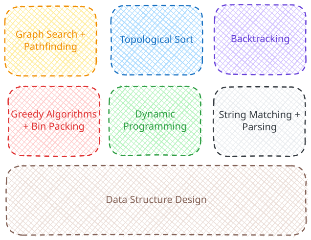

###### Overview

# Patterns

Why companies choose specific problem types for AI coding interviews, and a map of the patterns you'll encounter.

Companies don't pick AI coding problems at random. The reason you see the same kinds of problems over and over is deliberate: they're challenging enough to allow for multiple paths and non-obvious solutions, but not so complicated that they can't fit in a 45-minute interview. You're less likely to encounter problems focused on simple leetcode easy/medium, in part because AI squashes them immediately and there's nothing interesting to cover.

This balance is actually rather unstable! Companies are constantly evolving AI coding rounds as models become better at solving problems. What we hear from the teams responsible for the process is that they continually assess with new releases to make sure AI can't one-shot the problems.

This is actually helpful in anticipating what the interview is going to cover. The problems that survive the AI filter tend to cluster around a handful of algorithmic patterns, things like dependency resolution, constraint satisfaction, and graph traversal. These problems require you to *think* about which approach to use before you prompt. AI can implement topological sort just fine, but it can't look at a vague feature request and decide that topological sort is what's needed. That's your job.

## How patterns change in AI coding interviews

In a traditional interview, knowing patterns saved you time. In an AI-enabled interview, knowing patterns is what lets you steer the AI toward the right approach and follow the solution it hands back, instead of nodding along to code you don't fully understand. The AI handles the implementation. What you bring is the judgment behind it. Think about it like more bandwidth for the conversation rather than ready-made templates.

This is a double-edged sword. One mistake we see constantly from candidates is that they have a vague (wrong) idea of how to solve a problem. When they ask the AI with some specificity, the output they get is a contorted version that's skewed to what they asked for. If you ask for a "sliding window" solution to a graph problem, the AI will work really hard to satisfy your request even if it's not the right approach.

The difference between candidates who ace these interviews and those who struggle is how quickly they can map a problem to a known approach, communicate that approach to the AI with enough specificity that the output is useful, and are ready to understand and verify outputs that might actually be pretty deep. You won't be able to learn "monte carlo tree search" during your interview, but if you know it in advance you're going to be much more effective when it enters the conversation either as a response from the AI or as an obvious part of the solution to the problem.

## The patterns

Patterns you'll see in AI coding interviews

Here's a quick tour:

**[Graph Search & Pathfinding](/learn/ai-coding/patterns/graph-search)** shows up whenever the problem involves navigating networks, finding shortest paths, or exploring connected structures. BFS, DFS, Dijkstra's, and A\* are the workhorses.

**[Topological Sort](/learn/ai-coding/patterns/topological-sort)** appears in any problem with dependencies: build systems, course prerequisites, task scheduling. If things need to happen in a specific order, you're probably looking at a DAG (a directed acyclic graph, where tasks are nodes and dependencies are one-way edges with no cycles).

**[Backtracking](/learn/ai-coding/patterns/backtracking)** is the go-to for constraint satisfaction problems. Configuration generators, puzzle solvers, scheduling with complex rules. You try options, check constraints, and undo when you hit a dead end.

**[Greedy & Bin Packing](/learn/ai-coding/patterns/greedy-algorithms)** covers problems where local optimization leads to good-enough global solutions. Resource allocation, interval scheduling, packing items into containers.

**[Dynamic Programming](/learn/ai-coding/patterns/dynamic-programming)** handles problems with overlapping subproblems. Edit distance, resource allocation with constraints, path counting. The classic "have I solved a smaller version of this before?" pattern.

**[String Matching & Parsing](/learn/ai-coding/patterns/string-matching)** covers pattern matching, text processing, and building simple parsers. Regex-style matching, expression evaluation, template engines.

**[Data Structure Design](/learn/ai-coding/patterns/data-structure-design)** tests whether you can compose primitives (maps, heaps, queues) into custom structures that satisfy specific performance constraints. LRU caches, time-based key-value stores, that sort of thing.

Each pattern page goes deep on the specific approach: what problems it solves, how to recognize it, what to tell the AI, and how to verify the output. The goal is a general feel for how to solve a family of problems, not a precise mapping from pattern to problem. Many problems will pull in more than one. Recognizing the shape is your job, and the AI is there to help you build it.

If you're short on time, at minimum understand graph search, topological sort, and backtracking. Those three cover the majority of problems we've been seeing lately.
