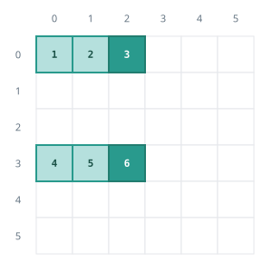
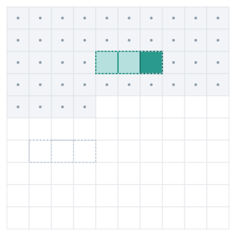
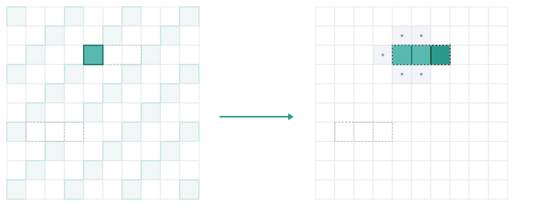

###### Problem Breakdown

# Battleship

Published Feb 16, 2025·

easy

###### Try This Problem Yourself

Practice in the AI-enabled editor with real-time feedback

You're given a Board that hides a fleet of ships on an n × n grid. Your solution has to fire shots until every ship is sunk, tracking each shot it takes. Every call to check\_shot(row, col) returns one of three results. A HIT means there's a ship cell there and it's not yet destroyed. A SUNK means the shot was the last cell of a ship. A MISS means the cell is empty water. Firing at a cell you already fired at returns MISS too, and still counts as a shot.



6x6 Battleship board with the Cruiser sunk across row 0 and the Submarine sunk across row 3, with shot numbers 1 through 6 showing the firing sequence

Your goal is, given a board, to sink all ships in as few shots as possible. There are two tests that ship with the problem and they check different things. The first places the fleet on a 6x6 board and only checks that every ship ends up sunk, no matter how many shots it takes to get there. The second test is the efficiency test, and it runs on a 10x10 board across 20 random layouts, asking your solution to average fewer than 50 shots across those games. In both tests the fleet is the same, a Cruiser and a Submarine, each 3 cells long.

## Solution 1, the full scan

The most natural solution is the one that treats the grid like a nested loop. For every row, walk every column, fire at the cell, record the shot, and stop once every ship is down. There's no strategy here. We're just checking every single cell in reading order.

This works because the grid is finite. If you fire at every cell exactly once, you will have hit every ship's cells, and all\_sunk() will flip true somewhere along the way. The worst case is the ship you discover last sits in the bottom-right corner, and you fire at nearly every cell before the loop exits.



A 10x10 board mid-scan. Forty-four cells have been fired at in reading order, one ship is already sunk in the top half, the other is still undiscovered in the lower half.

The diagram shows the scan partway through a game. The solution has fired at the first forty-four cells in reading order. It found the Cruiser in row 2, hit its three cells one after the other, and sunk it. The Submarine in row 6 is still untouched. The solution will keep scanning rows 4, 5, 6, and will only stop when it hits the Submarine's last cell. Nothing in the algorithm knows that the Cruiser's sinking was useful information.

Full scan

```
def solve(self) -> None:
    for row in range(self.board.grid_size):
        for col in range(self.board.grid_size):
            self.board.check_shot(row, col)
            self.shots.append((row, col))
            if self.board.all_sunk():
                return
```

The early exit on all\_sunk() saves every shot after the last SUNK returns. Without it, the solution keeps firing until the outer loops finish, which on a 10x10 with ships in the top half costs dozens of extra shots. Deduplication isn't a concern here because the nested loops never revisit a cell, so the shots list is just an append-only record. The solution itself stays stateless, because everything that matters (hit cells, missed cells, sunk ships) lives on the Board and the solution just leans on check\_shot and all\_sunk() for the game state.

### Complexity

Let n be the grid size. The loop fires at up to n² cells, each call to check\_shot does a constant-ish amount of work on the Board, so the shot count is O(n²) in the worst case. On the 10x10 efficiency test that's up to 100 shots per game, with all\_sunk() trimming some of the tail.

### Where it breaks

The 6x6 test cases pass. The 10x10 test cases don't. On the 10x10 board the solution averages **68.30** shots per game, well over the 50-shot budget. Every HIT is treated the same as every MISS, and the solution moves on to the next cell in reading order without using what it just learned.

###### Pattern: Greedy & Bin Packing

Once you've landed a hit, the smart move is to keep firing at the cells around it before going back to random search. That's a greedy choice, take the locally best shot each turn, and it's the same instinct behind the bin-packing problems in this pattern.

[Learn This Pattern](/learn/ai-coding/patterns/greedy-algorithms)

## Solution 2, hunt and target

Two ideas work together here. The first is a sparse **hunt** pattern that still guarantees hitting every ship. The second is a **target** mode that kicks in after any HIT and blitzes the neighbors of the hit cell until the ship sinks. Put them together and the solution spends most of its turns on cells that are either likely to reveal a new ship or already known to be next to one.

### The hunt pattern

The test fleet's smallest ship is 3 cells long, and every ship is axis-aligned. That means every ship occupies three consecutive cells in a row or column. If you number cells by (row + col), those three consecutive cells always have three consecutive values. Three consecutive integers always include exactly one that's divisible by 3.

To see why, consider a horizontal ship sitting at row r, columns c, c+1, c+2. The cell sums are r+c, r+c+1, and r+c+2. Those three values are consecutive, so their remainders mod 3 are 0, 1, and 2 in some rotation. Exactly one of them is 0. A vertical ship at column c, rows r, r+1, r+2 works out identically. So no matter where a 3-cell ship sits on the board, one of its cells always satisfies (row + col) % 3 == 0.

So if you only fire at cells where (row + col) % 3 == 0, every ship of size 3 or more has at least one of its cells in your hunt set. You cannot miss a ship this way. You just skip roughly two-thirds of the board while still hitting everything that matters. On a 10x10 there are 34 such cells, down from 100. That's because 10² / 3 ≈ 33.3, and the diagonal pattern rounds up to 34 when the remainder cells land on the edges.

### The target phase

The moment the hunt phase returns a HIT, you know a ship is there but you don't yet know which way it runs. The simplest reaction is to queue up all four neighbors of the hit cell and fire at them next. Most of those neighbors will miss, but at least one is usually another ship cell and returns HIT. That second HIT gives you the direction, since now you know the ship's axis, so you only need to keep firing along that line and you finish the ship a few shots later.

A FIFO queue is the right shape for this, the same breadth-first pattern covered in [BFS](/learn/code/breadth-first-search/introduction). You explore evenly around the first HIT instead of drilling in one direction and then backtracking. When the ship sinks, the queue drains, and the solution resumes the sparse hunt wherever it left off.



A 10x10 board split into two phases. The left panel shows the sparse mod-3 hunt pattern covering the board, with one cell fired that returned HIT on the Cruiser. The right panel shows the target sequence around that HIT, finishing the Cruiser with a SUNK.

The diagram shows one complete sink. On the left, the hunt phase has found the Cruiser with a single shot at (2, 4). That HIT triggers target mode. On the right, the solution fires at the four neighbors, gets a second HIT at (2, 5), queues that cell's neighbors, and finishes the Cruiser with a SUNK at (2, 6). That run costs eight shots in total. Three of them are ship cells, the two HITs and the final SUNK, and the other five are water cells around the ship that got fired at while target mode was still figuring out the direction. Once the Cruiser is down, both phases unwind and the sparse hunt picks back up wherever it left off on the board.

Hunt + target

```
def solve(self) -> None:
    size = self.board.grid_size
    hunt = [(r, c) for r in range(size) for c in range(size) if (r + c) % 3 == 0]
    random.shuffle(hunt)

    tried: set[tuple[int, int]] = set()
    targets: deque[tuple[int, int]] = deque()

    while not self.board.all_sunk():
        if targets:
            row, col = targets.popleft()
        elif hunt:
            row, col = hunt.pop()
        else:
            return

        if (row, col) in tried:
            continue
        tried.add((row, col))

        result = self.board.check_shot(row, col)
        self.shots.append((row, col))

        if result in (ShotResult.HIT, ShotResult.SUNK):
            for dr, dc in [(-1, 0), (1, 0), (0, -1), (0, 1)]:
                nr, nc = row + dr, col + dc
                if 0 <= nr < size and 0 <= nc < size and (nr, nc) not in tried:
                    targets.append((nr, nc))
```

The tried set does real work, and it's worth pausing on. check\_shot on a cell you've already fired at still returns MISS, and that return value still counts as a shot against your budget. On top of that, target expansions regularly queue a cell that the hunt pattern has already visited at some earlier point in the game. It can happen the other way around too, where the hunt walks onto a cell that target mode already fired at during a previous ship's sink. Deduplicating on pop is what prevents those double-fires from burning through the shot count.

Both HIT and SUNK expand the target queue. You might expect only HIT to do that, because SUNK means the ship is already dead. But SUNK is still a ship cell, and its neighbors might belong to a completely different ship sitting right next to the one you just finished. The test fleet allows ships to be placed so their edges touch, so expanding on SUNK catches the start of the next ship immediately instead of waiting for the sparse hunt to rediscover it later.

The hunt list is shuffled rather than walked in row-major order, so consecutive runs explore different cells first. That matters because the benchmark averages 20 seeded games. If every run swept the board in the same order, a single favorable starting sequence could dominate the average and make the result look better than it really is. Shuffling spreads the shot count across trials and gives a more honest reading.

And the return when both queues empty is a safety valve. With the mod-3 guarantee, both queues going empty before all\_sunk() flips true shouldn't actually happen on the test fleet, because the hunt pattern is mathematically guaranteed to land on every 3-cell ship. The explicit return is still there so that the solution can't spin forever in the degenerate case where a shorter ship or a different fleet sneaks through the sparse pattern.

### Complexity

Worst case is still O(n²) shots because in principle the target queue could chase false alarms around the grid. In practice the shot count is dominated by how much of the sparse hunt set gets swept before every ship has been found and sunk. The hunt set has n² / 3 candidates on an n × n board (~34 cells on a 10x10), and target mode adds only a handful of shots per ship, typically a few wrong-direction neighbors plus the ship's own cells. Those extra target shots push the empirical average a bit above the raw hunt-set size, which is why 33.15 lands just above 34 when you might expect it to be lower. Because the ships are usually found well before the hunt set is exhausted, the average ends up close to n² / 3, around 33 shots on a 10x10, still comfortably under the 50-shot budget.

### Where it lands

On the 10x10 board the solution averages **33.15** shots per game, well under the 50-shot budget.

## Benchmarks

Both solutions on a 10x10 board, averaged over the 20 seeded games.

| Solution | Avg shots |
| --- | --- |
| full scan | 68.30 |
| hunt + target | 33.15 |

## Takeaways

The whole lesson lives in the gap between 68.30 and 33.15. Full scan is correct, meaning it does pass the first test, but it wastes shots because it treats every cell as independent from every other cell. Nothing it learned from the last shot changes what the next shot is going to be. Hunt+target uses the one piece of information that full scan was throwing away. After you HIT a cell, the next ship cell is almost certainly in one of four places next to it, because ships are contiguous and axis-aligned. The sparse mod-3 hunt gives you a coverage guarantee, so no ship of size 3 or larger can hide from it no matter where it gets placed. And target mode gives you a focused response once a ship shows its face, so you don't drift back to sweeping until the ship that started the chain is actually sunk. Neither half of the strategy works on its own. Target mode has nothing to target until the hunt pattern sets up the first HIT, and a pure hunt with no target phase would take a bunch of extra shots to finish each ship after finding it, which adds up fast across 20 trials.

The deeper shift is from *open-loop* to *closed-loop*. An open-loop solution fires the same shots regardless of what the board sends back from each call. The outputs of one step never influence the inputs of the next step. A closed-loop solution feeds the result of each shot back into the decision about the next shot, so the algorithm can react as it learns. Full scan is open-loop, and hunt+target is closed-loop. Whenever you have expensive probes, whether that's grid search with costly actions, a minesweeper-style puzzle, or any kind of adaptive sampling, closing the loop is usually the right fix when a naive solution runs long. The bar for what counts as smart here is pretty low too. You aren't solving a game tree or running probability-based placements over every possible ship location on the board. You're just remembering your last few HITs long enough to finish the ship that produced them. That's the smallest possible amount of state on top of the naive scan, and it's enough to cut the average from 68.30 shots down to 33.15.
