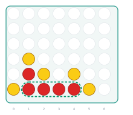
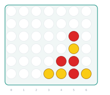
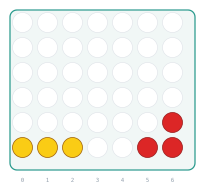
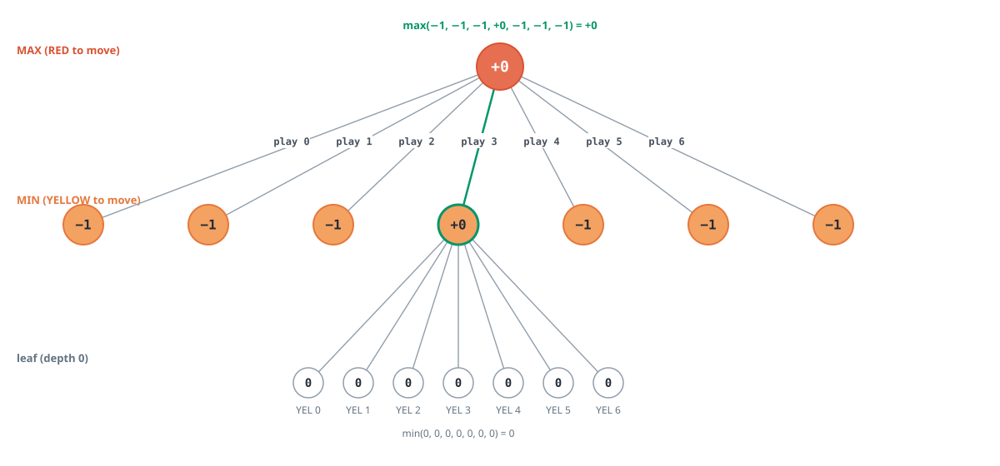
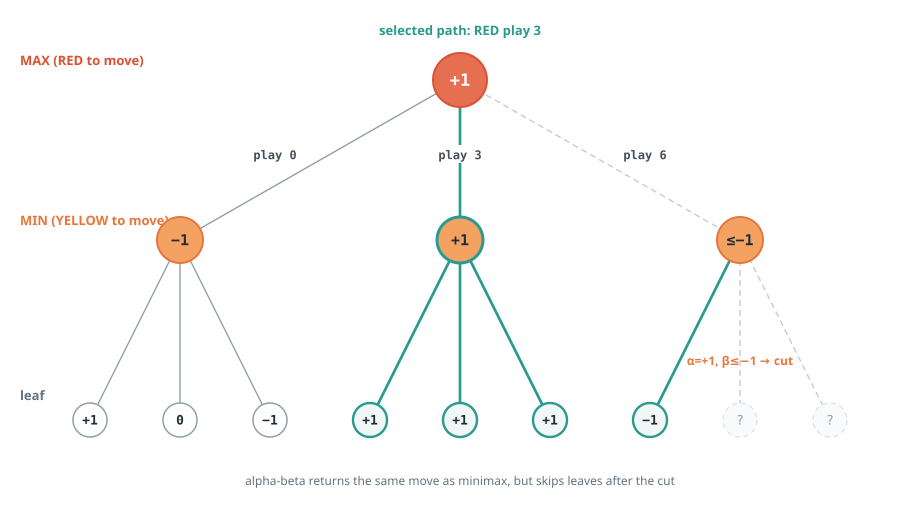
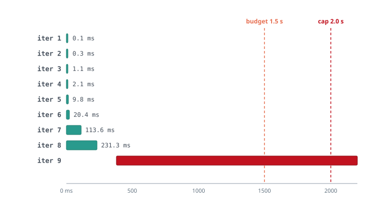
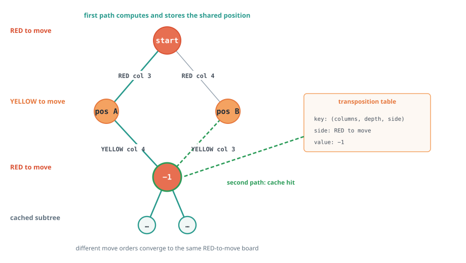

###### Problem Breakdown

# Connect Four

Published Feb 16, 2025·

hard

###### Try This Problem Yourself

Practice in the AI-enabled editor with real-time feedback

## Problem recap

Connect Four is the classic 7-column by 6-row board game where RED and YELLOW take turns dropping discs into columns. Discs fall to the lowest empty cell of whichever column they're dropped into. The first player to line up four of their own discs horizontally, vertically, or along either diagonal wins.



Connect Four board showing four red discs in a row across the bottom

Your job is to write a function that picks the best move from any board position. Given a board mid-game and whose turn it is, return the column that side should play. The grader feeds you a series of starting positions, calls your function on each, and checks the column you returned against the right answer. There's no second bot to play against; the "opponent" only exists inside your own thinking.

The catch is what *best* means. To pick the best move, you have to think ahead — and the further ahead you can think, the better moves you'll find. The grader covers two phases. Phase 2 has three warm-up positions:

* **One move ahead.** RED has three in a row across the bottom of cols 0, 1, 2. RED drops col 3 → win. You only need to look at your own immediate options.
* **Two moves ahead.** YELLOW has three in a row and threatens to win next turn at col 3. RED has to imagine YELLOW's reply *if RED ignores the threat*, see the loss coming, and play col 3 to block it. That's two moves of foresight: RED's move plus YELLOW's response.
* **Five moves ahead.** The hard one in Phase 2. RED is to move on the position below. The right move is col 3. It looks quiet, but the response forces YELLOW into a chain of blocks that lets RED build a double threat YELLOW can only partially answer. The win takes five plies to verify — three of RED's moves and two of YELLOW's replies — and at any shallower depth every legal move just scores 0.



Forced-win position used by the Phase 2 grader. RED to move; the win is five plies deep.

Phase 3 reuses the same find\_best\_move against four more positions whose forced wins land at varying depths — three plies, five plies, seven plies, and nine plies. The deepest two also have non-center winning columns, so a solver that defaults to col 3 when it can't see far enough doesn't accidentally pass. Phase 3 times each call externally and gives you a 2-second wall-clock cap per test. You don't get a budget parameter, and you don't know in advance how deep the win is — same function, harder inputs.

Each extra move of foresight roughly multiplies the work by 7 (one branch per column you might play). One move ahead means scoring 7 positions. Two moves is 49. Five moves is 7⁵ = 16,807. Nine moves is 7⁹ ≈ 40 million. And the grader times each call at 2 seconds.

The amount of foresight you need on the hard tests doesn't fit in the budget at any fixed depth. The four solutions below are four different ways of making a deeper search fit in less time.

###### Pattern: Backtracking

Minimax is backtracking with a scoreboard. You play a move, recurse into the opponent's replies, then undo it and try the next column. Alpha-beta pruning is the same move-skipping idea you'll see across backtracking problems.

[Learn This Pattern](/learn/ai-coding/patterns/backtracking)

## Solution 1: naive minimax

Imagine you're RED. You want to leave the game in a state where you've won, and YELLOW wants the opposite. Minimax is one recursive idea. At every level of the tree, alternate between what RED would pick and what YELLOW would pick. RED is the **maximizer** and picks the move with the highest score. YELLOW is the **minimizer** and picks the lowest. The two roles strictly alternate down the tree, because turns alternate.

To make this concrete, run minimax on a real position. It's RED's turn, and YELLOW has three discs across the bottom of cols 0, 1, 2, one move from winning at col 3.



Connect Four board where YELLOW threatens to win by playing column 3

The right move is col 3, which blocks YELLOW. Naive minimax has to figure that out from the rules of the game. We'll search to depth 2 (RED's move plus YELLOW's reply), which is the minimum depth at which the loss-on-the-next-turn becomes visible.

### The leaf-scoring rule

Every leaf in the search tree gets a score from looking at the board.

* **RED has 4 in a row** → +1
* **YELLOW has 4 in a row** → −1
* **Nobody has won** (we ran out of depth, or the board is full and it's a draw) → 0

That's the whole rule. No clever heuristic, no halfway scores. The third bullet covers two different states: "depth ran out, can't tell" and "game over, no winner." They share the same score because neither has a winner to point at.

### Walking the tree

RED tries all 7 columns at the root. For each RED move, YELLOW gets every legal reply, and each reply lands at a leaf scored by the rule above. YELLOW takes the minimum of its replies. RED takes the maximum of those minimums.



Game tree for the forced-block position. RED at the root has 7 column choices; for 6 of them YELLOW replies with col 3 and wins (-1); only RED's col 3 branch denies YELLOW that move, with all 7 leaves scoring 0.

For six of RED's seven branches, YELLOW can answer with col 3 and complete the 4-in-a-row, so those branches score −1. The exception is RED's own col 3 move. That blocks the threat, leaves no immediate winner, and scores 0 at depth 0. RED takes max(−1, −1, −1, 0, −1, −1, −1) = 0, so it plays col 3.

Naive minimax

```
WIN_SCORE = 1
MAX_DEPTH = 6

def find_best_move(self):
    moves = self.board.valid_moves()
    if not moves:
        return None

    is_max = self.board.current_player == Player.RED
    best_move = moves[0]
    best_score = -WIN_SCORE if is_max else WIN_SCORE

    for col in moves:
        self.board.drop_disc(col)
        score = self._minimax(MAX_DEPTH - 1, not is_max)
        self.board.undo_move()
        if is_max and score > best_score:
            best_score, best_move = score, col
        elif not is_max and score < best_score:
            best_score, best_move = score, col
    return best_move

def _minimax(self, depth, is_max):
    winner = self.board.check_winner()
    if winner == Player.RED:
        return WIN_SCORE
    if winner == Player.YELLOW:
        return -WIN_SCORE
    if depth == 0 or self.board.is_full():
        return 0

    moves = self.board.valid_moves()
    if is_max:
        best = -WIN_SCORE
        for col in moves:
            self.board.drop_disc(col)
            best = max(best, self._minimax(depth - 1, False))
            self.board.undo_move()
        return best
    else:
        best = WIN_SCORE
        for col in moves:
            self.board.drop_disc(col)
            best = min(best, self._minimax(depth - 1, True))
            self.board.undo_move()
        return best
```

There are two functions, not one. find\_best\_move is the wrapper. It loops over the legal columns and remembers which column produced the best *score*, then returns the *column*. \_minimax is the recursive helper that returns just a score. The split exists because the root needs to know which move to play, while every level below only ever needs scores. The wrapper reads is\_max off current\_player, so when YELLOW is to move the same code does the right thing. YELLOW becomes the minimizer at the root.

Inside \_minimax, the terminal check (check\_winner) runs before the depth check. A position where someone has already won has a definite score regardless of how much budget remains. If the depth check came first, we'd score a forced-loss as 0 just because we ran out of recursion budget on the same call where the game actually ended.

The two halves of if is\_max / else are mirror images. Maximizer starts best = −1 and takes max. Minimizer starts best = +1 and takes min. Those starting values are sentinels: as soon as you see a draw or a win, they update in the right direction.

Each recursive call evaluates a slightly different board, the one after the move just imagined. Copying the whole board on every call would mean ~117,000 fresh allocations at depth 6, each one duplicating every cell. Instead, drop\_disc and undo\_move mutate one board in place. Play the move, recurse, undo. Every iteration of the loop ends with the board in the same state it started, so a single board object survives the entire search. The same explore-and-undo pattern shows up in [backtracking](/learn/code/backtracking/overview), where the recursion mutates a candidate solution and rolls it back on the way out.

### Complexity

Let b be the branching factor and d the depth. Branching is at most 7 (one move per column), shrinking as columns fill up, so leaves grow like bᵈ. At d=4 that's roughly 2,400 leaves. At d=6, about 117,000. Each leaf evaluation is a constant-time terminal check, so the total cost is O(bᵈ) with a small per-node constant.

### Where it breaks

Run naive minimax on the deepest Phase 3 position (mate in nine plies, RED to move) at each depth and time it.

| max\_depth | wall-clock | finds the win? |
| --- | --- | --- |
| 4 | 42 ms | no — depth too shallow |
| 5 | 313 ms | no |
| 6 | 2.26 s | no, and over the 2-second cap |
| 8 | (~95 s) | yes, but ~50× over the cap |

There is no fixed depth for naive minimax that's both correct *and* fits inside the cap. Below depth 9, the win is invisible and every move scores 0; the solver picks whatever the move-ordering default is. At depth 9 you need ~40 million leaf evaluations, which takes roughly 30 seconds even after drop\_disc/undo\_move saves you the allocations.

A different fixed depth doesn't help. The recursion is doing huge amounts of work that doesn't change the answer. Once the maximizer at the root has found a child guaranteed to score +1, nothing can beat it, so any branch whose best possible score is already worse than something we've found is wasted work. Skip those, and the same depth fits in a fraction of the time.

## Solution 2: alpha-beta with center-first ordering

Alpha-beta is plain minimax with two extra numbers carried through the recursion. alpha is the best score the maximizer has guaranteed so far on the current path. beta is the best score the minimizer has guaranteed. In the code they start at -WIN\_SCORE and +WIN\_SCORE; the diagrams still label wins as +1 and losses as −1 because the idea is the same.

Suppose you're inside a minimizer node. You evaluate one child and get back a score of -1. The minimizer is going to take whatever child is *worst for the maximizer*, so the value of this minimizer node is at most -1. But up the call stack, the maximizer has already secured alpha = +1 from a different subtree. The maximizer would never choose a path that leads here, since +1 beats -1. Whatever the remaining children of this minimizer would have produced is irrelevant to the answer at the root. Stop and return.

The check is alpha >= beta. Once that holds, you break out of the move loop. The pruning is **sound**: it never changes the answer that plain minimax would have produced. It just skips subtrees the opponent has already proven they wouldn't allow.

Move ordering pairs naturally with alpha-beta. A cut only happens after you've found a "good enough" child. If you visit good moves first, cuts come earlier and prune more. In Connect Four the center column participates in more potential 4-in-a-row lines than any other column (there are 4-in-a-rows passing through col 3 in horizontal, two diagonals, and vertical), so it's a strong heuristic guess. Try center first, then 2 and 4, then 1 and 5, then 0 and 6.



Alpha-beta cut on the same tree

A generic illustration of the cut, not the same forced-block position from the previous diagram. The maximizer's left subtree returns -1, the middle returns +1, and the right subtree gets cut: its first child evaluates to -1, which caps the whole right minimizer at -1, worse than the +1 already in hand. The remaining two leaves on the right are skipped without being evaluated.

Alpha-beta with center-first ordering

```
WIN_SCORE = 1000
MAX_DEPTH = 6
CENTER_FIRST = [3, 2, 4, 1, 5, 0, 6]

def find_best_move(self):
    valid = set(self.board.valid_moves())
    if not valid:
        return None
    moves = [c for c in CENTER_FIRST if c in valid]

    is_max = self.board.current_player == Player.RED
    best_move = moves[0]
    best_score = -WIN_SCORE if is_max else WIN_SCORE
    alpha, beta = -WIN_SCORE, WIN_SCORE

    for col in moves:
        self.board.drop_disc(col)
        score = self._ab(MAX_DEPTH - 1, alpha, beta, not is_max)
        self.board.undo_move()
        if is_max:
            if score > best_score:
                best_score, best_move = score, col
            alpha = max(alpha, best_score)
        else:
            if score < best_score:
                best_score, best_move = score, col
            beta = min(beta, best_score)
    return best_move

def _ab(self, depth, alpha, beta, is_max):
    winner = self.board.check_winner()
    if winner == Player.RED:
        return WIN_SCORE
    if winner == Player.YELLOW:
        return -WIN_SCORE
    if depth == 0 or self.board.is_full():
        return 0

    valid = set(self.board.valid_moves())
    moves = [c for c in CENTER_FIRST if c in valid]

    if is_max:
        v = -WIN_SCORE
        for c in moves:
            self.board.drop_disc(c)
            v = max(v, self._ab(depth - 1, alpha, beta, False))
            self.board.undo_move()
            alpha = max(alpha, v)
            if alpha >= beta:
                break
        return v
    else:
        v = WIN_SCORE
        for c in moves:
            self.board.drop_disc(c)
            v = min(v, self._ab(depth - 1, alpha, beta, True))
            self.board.undo_move()
            beta = min(beta, v)
            if alpha >= beta:
                break
        return v
```

One detail in the code is worth pausing on. The move list is rebuilt as CENTER\_FIRST filtered by what's actually playable (some columns may be full). The set built from valid\_moves() is there for cheap membership lookup, since the filter walks all seven center-ordered columns and asks about each one. Inside the loop, alpha and beta are updated *after* each child's score, before the cut check. The cut uses alpha >= beta, not strict >, because equal values give the opponent nothing to gain from continuing.

The leaf-scoring rule also gets an upgrade here. Instead of +1 / 0 / −1, this solution and everything after it use WIN\_SCORE = 1000 for a win and -WIN\_SCORE for a loss. Solution 3 will nudge those scores by depth, and the extra room keeps a slow win from ever being scored worse than a draw. Naive minimax doesn't need any of that, so it stays at +1 / 0 / −1.

### Complexity

Worst case is still O(bᵈ) if move ordering is awful. With perfect ordering, alpha-beta reaches O(bᵈ⁄²), roughly the square root of the naive cost. The intuition: the maximizer fully expands every node it owns, but the minimizer only needs to find the first child that proves a cut. So levels alternate between expanding all b children and expanding 1, and the leaf count works out to bᵈ⁄² · 1ᵈ⁄² = bᵈ⁄².

For Connect Four with center ordering, the effective branching factor sits around 2 to 3 in practice. At depth 6 that's a few hundred leaves instead of 117,000.

### Where it leaves you

This is a huge improvement on the same depth-9 position:

| max\_depth | naive | alpha-beta + center | speedup |
| --- | --- | --- | --- |
| 5 | 313 ms | 9.4 ms | 33× |
| 6 | 2.26 s | 18.4 ms | 123× |
| 8 | (~95 s) | 221 ms | ~430× |
| 9 | — | 1.50 s | — |

Depth 8 fits comfortably inside the 2-second cap, but on this position the win is at depth 9 — so depth 8 still picks the wrong move (every leaf at the limit returns 0 and center-first ordering picks col 3, which isn't the winning column here). Depth 9 finds the win in 1.5 seconds, just under the cap. But on a *different* position with more open columns or fewer cuts, depth 9 might take 3 seconds. The numbers above are for one specific position; the next test could shift them.

The fundamental problem is that the solver still picks a fixed depth. Phase 3 hands you four positions whose win-depths and tree shapes vary, and there is no single fixed depth that's correct on the deepest one and fast on the most open one. Hard-coding a depth is betting on a measurement that won't hold across the suite.

The test asks the question "given this board, return a winning column within 2 seconds." Pick an algorithm that answers *that* question.

## Solution 3: iterative deepening

Run depth 1, then depth 2, then depth 3, and so on. After each completed iteration you have a "best move so far" from a search of that depth. Before starting iteration d+1, predict whether it'll fit in the remaining budget. If yes, go. If no, return the best move from the deepest completed iteration.

The pattern honors the budget by stopping before it overshoots, and it always has a deepest-completed move ready to return — truncation is graceful, not catastrophic. The catch you might worry about is wasted work, since each iteration redoes everything the previous iteration did. But alpha-beta's effective branching of around 2–3 means each iteration is roughly 3–4× the previous one, so if the deepest iteration takes time T, the shallower ones sum to a geometric series T/3 + T/9 + T/27 + … ≈ T/2, putting the total at around 1.5T. You pay maybe 1.5× the cost of a single fixed-depth search and get the budget-honoring behavior on top.

The code's "next iter ≈ 4× last iter" prediction is the conservative end of that 3–4× range. Better to skip an iteration that would have just barely fit than start one that blows the budget.



Per-iteration wall-clock for ID without TT on the depth-9 Phase 3 position. Iterations 1-8 complete in ~380 ms; iteration 9 alone takes ~1.9 s, pushing total wall-clock past the 2-second cap.

The bars are wall-clock times for each iteration on the depth-9 position, no transposition table. Iterations 1 through 8 complete inside roughly 380 ms cumulative. Iteration 9 alone takes ~1.9 s. The "next iter ≈ 4× last iter" heuristic guesses ~920 ms based on iteration 8's 230 ms, predicts the next one will fit, and starts iteration 9. It runs to completion at ~2.3 s — over the 2-second cap. With a tighter internal budget the prediction would refuse to start iteration 9, but then the solver returns the iteration-8 answer, which is the wrong column on this position. Either way, ID by itself doesn't fit the deepest position. Solution 4 fixes that.

Iterative deepening over alpha-beta

```
import time

WIN_SCORE = 1000
CENTER_FIRST = [3, 2, 4, 1, 5, 0, 6]
BUDGET_S = 1.5
MAX_DEPTH_CAP = 42

def find_best_move(self):
    valid = set(self.board.valid_moves())
    if not valid:
        return None
    moves = [c for c in CENTER_FIRST if c in valid]

    deadline = time.monotonic() + BUDGET_S
    best = moves[0]
    depth = 1
    last_iter = 0.0
    while depth <= MAX_DEPTH_CAP and time.monotonic() + last_iter < deadline:
        t0 = time.monotonic()
        best = self._search(depth)
        last_iter = (time.monotonic() - t0) * 4
        depth += 1
    return best

def _search(self, depth):
    valid = set(self.board.valid_moves())
    moves = [c for c in CENTER_FIRST if c in valid]

    is_max = self.board.current_player == Player.RED
    best_move = moves[0]
    best_score = -WIN_SCORE if is_max else WIN_SCORE
    alpha, beta = -WIN_SCORE, WIN_SCORE

    for col in moves:
        self.board.drop_disc(col)
        score = self._ab(depth - 1, alpha, beta, not is_max)
        self.board.undo_move()
        if is_max:
            if score > best_score:
                best_score, best_move = score, col
            alpha = max(alpha, best_score)
        else:
            if score < best_score:
                best_score, best_move = score, col
            beta = min(beta, best_score)
    return best_move

def _ab(self, depth, alpha, beta, is_max):
    winner = self.board.check_winner()
    if winner == Player.RED:
        return WIN_SCORE - (100 - depth)
    if winner == Player.YELLOW:
        return -WIN_SCORE + (100 - depth)
    if depth == 0 or self.board.is_full():
        return 0

    valid = set(self.board.valid_moves())
    moves = [c for c in CENTER_FIRST if c in valid]

    if is_max:
        v = -WIN_SCORE
        for c in moves:
            self.board.drop_disc(c)
            v = max(v, self._ab(depth - 1, alpha, beta, False))
            self.board.undo_move()
            alpha = max(alpha, v)
            if alpha >= beta:
                break
        return v
    else:
        v = WIN_SCORE
        for c in moves:
            self.board.drop_disc(c)
            v = min(v, self._ab(depth - 1, alpha, beta, True))
            self.board.undo_move()
            beta = min(beta, v)
            if alpha >= beta:
                break
        return v
```

The deadline check sits between iterations, never inside the recursion. Bailing mid-search by raising or returning early skips the matching undo\_move calls and corrupts the board state, and every subsequent iteration explores garbage. So the loop only checks the deadline between full iterations, predicting whether the next one will fit. The internal BUDGET\_S = 1.5 leaves comfortable margin under the 2-second test cap; the candidate picks the budget themselves since the constructor takes only the board.

The WIN\_SCORE - (100 - depth) adjustment in the terminal score is a small but useful trick. A win found in fewer plies scores higher than one that takes longer, and a loss that takes longer scores higher (less bad) than one that comes immediately. This biases the solver toward winning *fast* and losing *slow*, which is what a real player wants. The 100 is a comfortable upper bound on plies the search will ever reach in this problem; it just keeps the depth nudge small relative to WIN\_SCORE = 1000 so it never swamps the win/loss signal.

The recursion does not check the deadline. Time-budget enforcement is one of those things that looks easy to add deep in the call stack and is actually painful, because every escape path has to also unwind the board state. Predict between iterations, never inside.

The asymptotic complexity is the same O(bᵈ⁄²) as Solution 2. The win here is practical: a fixed-depth search has become a fixed-budget search. ID handles the easier Phase 3 positions cleanly — depth 7 finishes inside 150 ms, depth 5 inside 15 ms, depth 3 instantly — so the suite's first three positions all pass. The depth-9 position is what trips it up.

The work iterative deepening leaves on the table is that each iteration starts from depth 1 again, re-evaluating positions the previous iteration already saw. Two different move orders can reach the same board, and the solver re-explores that board's subtree every time. A position is fully determined by its column stacks and whose turn it is — the path that produced it doesn't matter — so caching the score the first time we evaluate a position lets us return it directly the next time the search lands there. On the depth-9 position, that's the difference between a 1.9-second iteration and a 0.6-second one.

## Solution 4: transposition table

A transposition table is plain memoization applied to game-tree search. The cache stores a score for each position the recursion has already evaluated, and returns the cached score the next time the recursion lands on the same position. Each piece of the cache key has to be there for the cache to be correct.

* **Board state.** Two positions with the same column contents are the same problem regardless of how you got there. Without this part of the key, no caching happens at all.
* **Depth remaining.** A score "computed to depth 6" is more reliable than one "computed to depth 2". You can't reuse a shallow score in a deeper search, because the shallow score may have hit the depth limit and returned 0 without seeing a win that's just one ply further. Including depth in the key keeps shallow and deep scores in separate cache slots.
* **Side to move.** The same column contents with RED to move and with YELLOW to move are different game states with different legal continuations. They produce different game trees, so they can't share a cache slot.

Why caching helps so much in Connect Four: the same column stacks are reachable through *many* different move orders. Drop col 3 then col 4 lands at the same board as drop col 4 then col 3, and at deeper search both paths are explored. The deeper the search, the more often a position recurs.



Two move orders converge at the same position

Two paths from start reach the same board through different move orders. The first path computes the score for the shared position and stores it in the table. The second path's recursion hits the same key and returns the cached value, skipping the entire subtree below.

Iterative deepening + alpha-beta + transposition table

```
import time

WIN_SCORE = 1000
CENTER_FIRST = [3, 2, 4, 1, 5, 0, 6]
BUDGET_S = 1.5
MAX_DEPTH_CAP = 42

def find_best_move(self):
    valid = set(self.board.valid_moves())
    if not valid:
        return None
    moves = [c for c in CENTER_FIRST if c in valid]
    self._tt = {}

    deadline = time.monotonic() + BUDGET_S
    best = moves[0]
    depth = 1
    last_iter = 0.0
    while depth <= MAX_DEPTH_CAP and time.monotonic() + last_iter < deadline:
        t0 = time.monotonic()
        best = self._search(depth)
        last_iter = (time.monotonic() - t0) * 4
        depth += 1
    return best

def _search(self, depth):
    valid = set(self.board.valid_moves())
    moves = [c for c in CENTER_FIRST if c in valid]

    is_max = self.board.current_player == Player.RED
    best_move = moves[0]
    best_score = -WIN_SCORE if is_max else WIN_SCORE
    alpha, beta = -WIN_SCORE, WIN_SCORE

    for col in moves:
        self.board.drop_disc(col)
        score = self._ab(depth - 1, alpha, beta, not is_max)
        self.board.undo_move()
        if is_max:
            if score > best_score:
                best_score, best_move = score, col
            alpha = max(alpha, best_score)
        else:
            if score < best_score:
                best_score, best_move = score, col
            beta = min(beta, best_score)
    return best_move

def _state_key(self):
    parts = []
    for c in range(7):
        h = self.board.column_height(c)
        parts.append("".join(self.board.get_cell(r, c).value for r in range(h)))
    return "|".join(parts)

def _ab(self, depth, alpha, beta, is_max):
    winner = self.board.check_winner()
    if winner == Player.RED:
        return WIN_SCORE - (100 - depth)
    if winner == Player.YELLOW:
        return -WIN_SCORE + (100 - depth)
    if depth == 0 or self.board.is_full():
        return 0

    key = (self._state_key(), depth, is_max)
    if key in self._tt:
        return self._tt[key]

    valid = set(self.board.valid_moves())
    moves = [c for c in CENTER_FIRST if c in valid]

    if is_max:
        v = -WIN_SCORE
        for c in moves:
            self.board.drop_disc(c)
            v = max(v, self._ab(depth - 1, alpha, beta, False))
            self.board.undo_move()
            alpha = max(alpha, v)
            if alpha >= beta:
                break
    else:
        v = WIN_SCORE
        for c in moves:
            self.board.drop_disc(c)
            v = min(v, self._ab(depth - 1, alpha, beta, True))
            self.board.undo_move()
            beta = min(beta, v)
            if alpha >= beta:
                break

    self._tt[key] = v
    return v
```

The dictionary key is built from a small state\_key helper that walks column\_height and get\_cell to produce a stable string per column — same shape in every language. The full cache key is (state\_key, depth, side\_to\_move), hashed by the standard library hash table.

The cache is created fresh in each call to find\_best\_move and survives across the iterative-deepening iterations of that call. Depth 7 reuses every score depth 6 cached, which is most of why the TT pays for itself even on a single move. Dropping the cache between calls is a memory-and-simplicity choice, not a correctness one — most positions visited last turn won't recur off the new root, so retaining the table mostly grows memory without buying much. A production engine would keep a fixed-size cache with an eviction policy instead of starting empty every turn.

The cache key has to include depth and side-to-move, not just the board cells. If you key only on the board, a depth-2 score will overwrite a depth-6 score (or vice versa), and stale shallow values will leak into deeper searches, producing wrong moves.

Asymptotically the worst case is still O(bᵈ⁄²). The win is in the constant factor, which keeps growing as the search goes deeper and transpositions become more common. On the depth-9 position, ID-with-TT completes iteration 9 in ~555 ms (vs ~1.9 s without TT), and the full search returns the winning column at ~740 ms — comfortably under the 2-second cap on every position in the suite. Full per-depth numbers are in the benchmark table below.

The cost is memory, which grows with the number of unique positions visited. Bounded under a 1.5-second budget, but a production engine would cap the table and evict old entries (least-recently-used or least-shallow are common policies).

## Benchmarks

Wall-clock on the depth-9 Phase 3 position. \* = wrong best move at that depth (the mate is at depth 9, so anything shallower can't see it). — = too slow to be worth running.

| depth | naive\_minimax | alpha\_beta + center | iter\_deepening | transposition |
| --- | --- | --- | --- | --- |
| 4 | 42 ms\* | 1.9 ms\* | 3.4 ms\* | 3.2 ms\* |
| 5 | 313 ms\* | 9.4 ms\* | 12.6 ms\* | 10.2 ms\* |
| 6 | 2.26 s\* | 18.4 ms\* | 32.1 ms\* | 24.1 ms\* |
| 7 | — | 119 ms\* | 144 ms\* | 84 ms\* |
| 8 | — | 221 ms\* | 379 ms\* | 186 ms\* |
| 9 | — | 1.50 s | 2.28 s | 741 ms |
| 10 | — | — | 6.00 s | 1.62 s |

Per-position outcome at the 2.0-second test cap (best move + wall-clock):

| variant | d3 (mate@3) | d5 (mate@5) | d7 (mate@7) | d9 (mate@9) |
| --- | --- | --- | --- | --- |
| naive\_minimax (depth=6) | 1.29 s | 1.97 s | **wrong** + 2.32 s | **wrong** + 2.31 s |
| alpha\_beta + center (depth=8) | 565 ms | 249 ms | 1.04 s | **wrong** + 222 ms |
| alpha\_beta + center (depth=9) | 1.95 s | 1.22 s | **3.00 s — over cap** | 1.49 s |
| iter\_deepening + TT (1.5 s budget) | 483 ms | 832 ms | 693 ms | 732 ms |

Reading the second table: every fixed-depth row fails at least one position. Naive at depth 6 misses the depth-7 and depth-9 mates. Alpha-beta at depth 8 fits all four positions in time, but it can't see the depth-9 mate and falls back to a non-winning column. Alpha-beta at depth 9 sees every mate, but the depth-7 position has more open columns to search and the work explodes past 3 seconds. Only ID + TT adapts: it deepens until the budget warns it to stop, returns the deepest completed iteration's best move, and the TT keeps iteration 9 cheap enough to fit on the open positions.

## Takeaways

The four solutions correspond to four mental moves you'll see again on adversarial-search problems:

1. Search the whole tree.
2. Skip subtrees the opponent has already proven they wouldn't allow.
3. Trade depth questions for time questions.
4. Cache results for positions reached more than one way.

The first is the algorithm; the rest are about making the algorithm fit a budget. The same ladder is the foundation of every serious chess and checkers engine. Naive minimax establishes correctness; alpha-beta + good move ordering makes it competitive; iterative deepening matches the API of "you have N seconds"; a transposition table picks up the free wins.

Connect Four itself was solved perfectly by John Tromp in 1995. The first player wins with optimal play, starting at the center column. Our 7×6 board with a 2-second cap is a microcosm of the real engineering problem. Your job is to find a strong move in time, on whatever position you happen to be handed.
