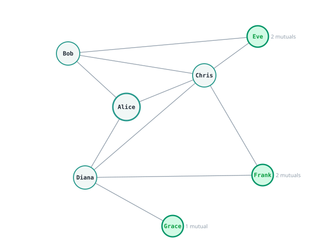
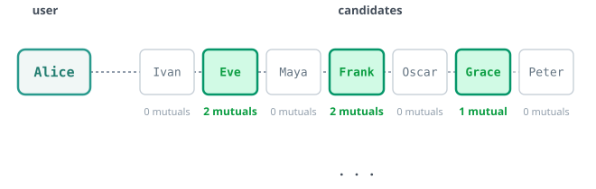
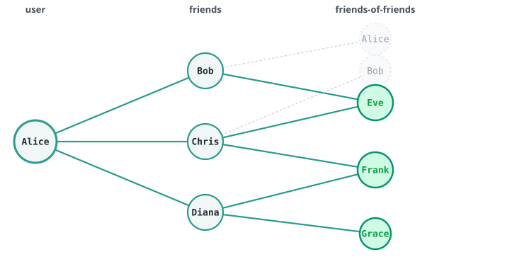

###### Problem Breakdown

# Friend Recommender

Published Feb 16, 2025·

medium

###### Try This Problem Yourself

Practice in the AI-enabled editor with real-time feedback

You're given a social network, which is a collection of users and their bidirectional friendships. For a given user, return up to 5 recommended friends ranked by the number of mutual friends they share with the user. Ties break alphabetically by name. The user cannot be recommended to themselves, existing friends are excluded, and candidates must share at least one mutual friend.



Small social graph with Alice at the center, her three direct friends in the inner ring, and her three recommendations Eve, Frank, and Grace highlighted on the outer ring

The code is split across two classes. SocialNetwork owns the adjacency data and exposes helpers for fetching a user's friends, counting mutuals between two users, and checking whether a candidate is a valid recommendation. Recommender holds a reference to one SocialNetwork and implements a single recommend method that takes a user and a maximum result count. Every solution below lives inside that one method.

## Solution 1, scan every user

The most natural solution is the literal restatement of the rules. You walk every user in the network, skip the invalid ones, count mutuals for each valid one, sort by those counts, and take the top five. The validity helper already combines the three exclusion rules into a single call, so the outer loop stays a clean filter.



Scanning every user in the network against Alice

The diagram shows one call to recommend("Alice") on a small slice of a much larger network. Most users in the network are strangers, meaning they share no friends with Alice, and the solution has to check each one to find that out. On the small example above the highlighted candidates Eve, Frank, and Grace are the only ones worth keeping. Every other box is rejected work.

Scan every user

```
def recommend(self, user: str, max_recommendations: int = 5) -> list[str]:
    candidates = []
    for candidate in self.network.get_all_users():
        if not self.network.is_valid_recommendation(user, candidate):
            continue
        count = self.network.mutual_friends_count(user, candidate)
        candidates.append((candidate, count))
    candidates.sort(key=lambda x: (-x[1], x[0]))
    return [name for name, _ in candidates[:max_recommendations]]
```

The validity helper does three jobs at once, rejecting self-recommendation, existing friends, and strangers with zero mutuals all in one pass. Because the mutual-count check happens inside the filter, every candidate that reaches the sort is guaranteed to have a positive score, so the zero-mutual candidates never make it into the ranked list in the first place. After that, the sort key is descending count then ascending name. The descending count makes higher-mutual candidates win, and the ascending name makes ties deterministic, because without the secondary key the order would depend on whatever iteration order the underlying map uses, which varies across languages and versions.

The cost driver is the mutual-count helper, which intersects two friend sets. A hash-set lookup is constant on average because the runtime hashes the key and jumps straight to the matching bucket without scanning, so one intersection of sets of size |A| and |B| takes about O(min(|A|, |B|)) work. The trick is that you iterate the smaller set and probe the larger one, so the cost scales with the smaller of the two rather than the sum. That cost is tiny per candidate, but it runs once for every valid candidate, which is what makes the outer loop expensive.

### Complexity

Let V be the number of users in the network and d the average friend-set size. The outer loop walks every user, which is O(V). Each valid candidate pays one set intersection, which is O(d) on average. The final sort of the kept candidates is at most O(V · log V) and usually much smaller. Comparison sorts do about V · log V work because each element moves through log V levels of merges or partitions before it lands in its final position.

Per query that totals roughly O(V · d). On the huge dataset with V = 5,000 and d ≈ 10, that's on the order of 50,000 operations per query, which is cheap in isolation. Across 200 queries it stops being cheap.

### Where it breaks

Correctness-wise this solution passes every test. The 200-query timing test on the huge network is what exposes the cost. Over 200 queries on 5,000 users, the reference run takes about 361.8 ms against a 200.0 ms budget, roughly 1.8x over. The scan spends most of its time on users who are obviously not worth recommending.

Stop visiting users who cannot possibly be valid in the first place.

###### Pattern: Graph Search & Pathfinding

Recommendations are just a two-hop walk over the friendship graph. Start at a user, step to their friends, then to friends-of-friends, which is the breadth-first traversal at the heart of this pattern.

[Learn This Pattern](/learn/ai-coding/patterns/graph-search)

## Solution 2, walk friends-of-friends

A valid candidate must share at least one mutual friend with the user. Restated in graph terms, a valid candidate is at [distance 2](/learn/code/breadth-first-search/introduction) from the user in the friendship graph (graph distance is the number of edges on the shortest path between two nodes, so distance 1 means a direct friend and distance 2 means a friend-of-a-friend). Anyone further away shares no friends with the user and cannot contribute. So only the 2-hop neighborhood of the user can contain valid candidates, and everyone outside that neighborhood is guaranteed to be rejected. If graph traversal on adjacency lists feels rusty, [the BFS graphs overview](/learn/code/breadth-first-search/graphs-overview) covers the fundamentals.

That rewrites the loop. Instead of scanning V users and checking each one for mutuals, walk the user's friends, and for each friend walk their friends. Because friendship is bidirectional, that inner walk will land on the user themselves and on the user's other direct friends. If A and B are friends, then B's friend list contains A, so when we walk B's friends from A's perspective we immediately encounter A again. Equally, if A is friends with both B and F, and B and F are also friends, then F appears in B's friend list. The skip checks inside the inner loop throw those out so only true distance-2 candidates end up in the score map, and both checks are cheap hash-set lookups.

The traversal also gives you the mutual count for free. Every time you reach the same 2-hop user through a different direct friend, that is literally one more mutual friend, so a map keyed by candidate name and incremented once per visit produces the exact same scores the scan produced, without any set intersection. For example, if candidate E is reached through both direct friends B and C, the score map increments twice, which is exactly the two mutual friends.



Two-hop walk from Alice through her three direct friends

The diagram shows Alice in the middle with her three direct friends in the next ring, and the friends-of-friends out on the right. Eve is reached through both Bob and Chris, so her score ends at 2. Frank is reached through both Chris and Diana, so his score is also 2. Grace is reached only through Diana, so her score is 1. Alice herself is reached through Bob (self, skip) and Bob is reached through Chris (already a friend, skip), so neither ends up in the score map.

Friends-of-friends walk

```
def recommend(self, user: str, max_recommendations: int = 5) -> list[str]:
    friends = self.network.get_friends(user)
    scores: dict[str, int] = {}
    for friend in friends:
        for ff in self.network.get_friends(friend):
            if ff == user or ff in friends:
                continue
            scores[ff] = scores.get(ff, 0) + 1
    ranked = sorted(scores.items(), key=lambda x: (-x[1], x[0]))
    return [name for name, _ in ranked[:max_recommendations]]
```

The skip checks live inside the inner loop. Every visit to a friend-of-friend pays a constant-time check against friends (the user's own friend set) and a constant-time comparison against user, both of which are hash-set operations. Doing them in the inner loop means the score map never contains self or existing friends, so the final sort does not need to filter them out. The score map itself replaces the mutual-count helper entirely. Reaching the same candidate through two different direct friends increments that candidate's score twice, which is exactly the definition of having two mutual friends with the user, and no set intersection is needed anywhere in the hot path. The sort and slice are identical to the scan version, using the same key, the same tie rule, and the same final slice, because the only thing that changed is how the score map got built.

### Complexity

Let u be the query user. The outer loop walks deg(u) direct friends. The inner loop walks deg(f) friends-of-friends for each direct friend f. Per query that is the sum of deg(f) over each direct friend f of the user. On a sparse graph with average degree d, each of the d direct friends has about d friends, so you visit about d · d = d² friend-of-friend entries total, making the worst case about d² operations per query. That cost grows with how connected the user is rather than with the total network size. On the huge dataset with d ≈ 10 that works out to around 100 operations per query, compared to 50,000 for the scan.

### Where it lands

Over 200 queries on the huge network the reference run takes about 7.6 ms, which is roughly 48x faster than the scan and well under the 200.0 ms budget. The speedup comes from not visiting 4,900 users who had zero chance of being valid.

The score map is keyed by candidate name, not by (user, candidate). A new score map is created on every call. If you tried to cache scores across calls, you would have to invalidate the cache on every edge addition, and the bookkeeping would cost more than the 7.6 ms you saved. The 2-hop walk is already fast enough that caching is a premature optimization for this problem.

## Benchmarks

| Dataset | Users | Edges | Scan all | 2-hop walk |
| --- | --- | --- | --- | --- |
| huge | 5,000 | 25,000 | 361.8 ms | 7.6 ms |

The scan is not slow in any absolute sense. Its cost is proportional to the whole network rather than to the user's neighborhood, and on a 5,000-user graph that proportionality blows the 200 ms budget. The 2-hop walk is not asymptotically perfect either. The worst case is still quadratic in the user's degree, and on a graph where every user has hundreds of friends (say a celebrity account with 1,000 followers who each follow 1,000 others) it would touch roughly a million users per query and close in on the scan's cost. It wins here because real social graphs are sparse and the 2-hop neighborhood of a typical user is tiny compared to the whole network.

## Takeaways

The main lesson here is in the shape of the constraint. The rules of the problem say a valid candidate must share at least one mutual friend with the user, and that single rule already restricts the search space to the 2-hop neighborhood. The scan solution ignores that restriction and pays for the whole network instead, but the local property names the neighborhood you actually have to visit.

There's a smaller lesson about building and counting in one pass, too. The scan solution built a candidate list and then asked the network for the mutual count of each one, whereas the 2-hop walk built the same scores incrementally during the traversal, since each visit was a mutual by definition. Whenever a cost and a traversal can be fused, fusing them is almost always worth it because it cuts both the work and the need for a second helper call.

When a problem constrains candidates to a local neighborhood and the traversal itself computes the ranking signal, walk the neighborhood. Scanning the whole universe works until it doesn't, and the whole-universe cost is what the fast test is measuring.
