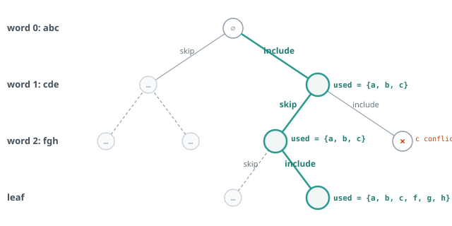
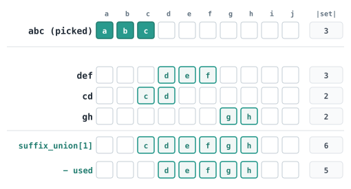
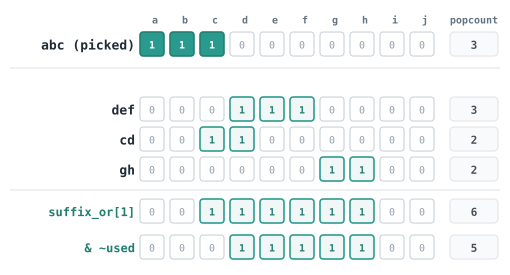

###### Problem Breakdown

# Maximize Unique Characters

Published Feb 16, 2025·

hard

###### Try This Problem Yourself

Practice in the AI-enabled editor with real-time feedback

You get a list of words and an alphabet. Your job is to pick a subset of words whose combined character coverage is as large as possible, where "combined" means no two picked words are allowed to share even one character.

```
["abc", "def"]              →  both, 6 unique chars
["abc", "cde", "fgh"]       →  abc + fgh, 6 unique chars ("cde" shares "c" with "abc")
["jan","feb",...,"dec"]     →  best is 12 chars, via the subset feb+mar+jun+oct
["abcdef", "abc", "def"]    →  either "abcdef" alone or "abc" + "def", tied at 6 chars
```

###### Pattern: Backtracking

Every word is an include-or-skip decision, and you explore those choices by recursing, then undoing, then trying the other branch. Adding a ceiling to cut off hopeless branches is textbook backtracking.

[Learn This Pattern](/learn/ai-coding/patterns/backtracking)

## Solution 1, backtracking over include/skip

The natural first frame is a binary decision tree. For each word in the list, you either skip it or include it (as long as its characters don't collide with anything you've already picked). At the bottom of the tree you've either built a legal subset or proved that this sequence of choices doesn't beat what you already have.

This is [backtracking](/learn/code/backtracking/overview) in its most literal form. The recursion depth is the number of words, each frame branches at most twice, and the state you carry down the tree is the set of characters already spent.



Decision tree for picking from abc, cde, fgh, showing the walked path and one rejected include branch

The diagram shows a tiny three-word input. Each node holds the used set at that point in the search, and each edge carries the decision that led there (skip or include). The walked path takes abc, is forced to skip cde because taking it would conflict on the letter c, and then takes fgh. That leaves six unique characters, which is the optimum. The rejected branch on the right side shows what happens when the include is illegal. The recursion never goes down that path at all.

Backtracking search

```
def solve(self) -> list[str]:
    words = self.word_list.valid_words()
    best_words: list[str] = []
    best_count = 0
    current: list[str] = []
    used: set[str] = set()

    def recurse(i: int) -> None:
        nonlocal best_words, best_count
        if i == len(words):
            if len(used) > best_count:
                best_count = len(used)
                best_words = list(current)
            return

        recurse(i + 1)

        word_chars = set(words[i])
        if used.isdisjoint(word_chars):
            added = word_chars - used
            used.update(added)
            current.append(words[i])
            recurse(i + 1)
            current.pop()
            used.difference_update(added)

    recurse(0)
    return best_words
```

The recursion explores the skip branch first and the include branch second. Either order produces a correct answer, but putting skip first keeps the state-restoration discipline front and center, since every mutation to used and current happens inside the include branch and every mutation is undone before the function returns. Skip never mutates anything.

Before recursing into the include branch, the code asks whether the word's character set is disjoint from used. If they overlap on even one character, the include branch is illegal and the code doesn't enter it; the skip branch is always legal. The disjointness check also guarantees that none of the word's characters were already in used, so every character in the new word is new. The added set records what was inserted so the restoration step removes exactly the same characters when the recursion returns. Getting that symmetry wrong is the most common source of bugs in a backtracking search.

### Complexity

Let n be the number of words. Each word is an include-or-skip choice, so the search tree has up to 2ⁿ leaves. At each frame the work is proportional to the word's length m for the disjoint check and the set update, so the total cost is O(m · 2ⁿ) in the worst case.

In practice the tree is much smaller than 2ⁿ because every included word rules out the words that conflict with it, collapsing entire subtrees. On the twelve-word months set, the whole search runs in about 71 microseconds. On the 250-word Wordle set, it finishes in about 106 milliseconds.

### Where it breaks

The 300-word large dataset has lengths from 2 to 6. Short words are the problem. Three-letter words like jig, mr, and pax collide with only a handful of other words, so conflict alone doesn't kill enough of the tree. With 30 two-letter words and 60 three-letter words in the pool, long chains of "include this short word" branches stay legal deep into the recursion. The measured time on this dataset is about 11.78 seconds, more than 100x slower than the 250-word Wordle run.

## Solution 2, pruning with a suffix-union ceiling

The tree is still exponential in the worst case. The way to cut it down is to notice that most branches can't possibly beat the best answer found so far, and abandon them before exploring them. branch-and-bound, applied to the same set-based search from Solution 1.

### The suffix-union ceiling

At any frame in the recursion, with some used set already committed, the best the rest of the search could possibly achieve is to grab every fresh letter that any remaining word could still contribute. Take the union of all remaining words' character sets, subtract the letters already in used, and the size of what's left is an optimistic ceiling on how many new characters the remaining subtree could add. It's always an over-estimate because it assumes every remaining word contributes all of its unused letters, which is the best possible case, so the real total can't exceed it. If |used| plus that ceiling already can't beat best\_count, the whole subtree is a guaranteed waste and there's no point exploring it.

The union of remaining word sets is worth precomputing. A single right-to-left pass builds a suffix\_union array where suffix\_union[i] is the union of character sets of words at indices i, i+1, ..., n-1. Build it right-to-left: start with the last word's character set, then at each earlier index set suffix\_union[i] = suffix\_union[i+1] ∪ chars(word[i]). Lookups into it are constant time, so the ceiling test adds basically nothing to the per-frame cost.

### Sorting by coverage

One more compounding trick is to sort the words by character-set size descending before you start. Walking the dataset from the highest-coverage word to the lowest means the first complete leg of the recursion lands on a strong answer quickly, and a higher best\_count is what makes the ceiling test fire on the rest of the search. Without this sort, the pruning bound still works, but the best-so-far stays low for longer and fewer subtrees get cut.



A frame of the search where the picked set shows a,b,c, three remaining words def/cd/gh have their char sets listed, suffix\_union excluding the already-spent c leaves d,e,f,g,h, and the ceiling of 8 equals the current best, triggering a prune

The diagram freezes the search at frame i = 1. The picked word abc has committed {a, b, c}. The three remaining words are def, cd, and gh, whose combined character set at suffix\_union[1] covers {c, d, e, f, g, h}. Subtracting the already-spent c leaves {d, e, f, g, h}, which is five letters. Add the three already used and the ceiling is eight. The best-so-far is also eight, so the condition ceiling ≤ best holds and the whole subtree gets pruned without the recursion ever entering it. Equal-to-best is safe to prune because any descendant would need to strictly exceed best, and the ceiling is already the highest value any descendant could possibly achieve.

Backtracking with suffix-union pruning

```
def solve(self) -> list[str]:
    words = self.word_list.valid_words()
    if not words:
        return []

    alphabet_size = len(self.word_list.alphabet())

    char_sets = [frozenset(w) for w in words]
    order = sorted(range(len(words)), key=lambda k: -len(char_sets[k]))
    sorted_words = [words[k] for k in order]
    sorted_sets = [char_sets[k] for k in order]
    n = len(sorted_words)

    suffix_union: list[frozenset[str]] = [frozenset()] * (n + 1)
    for i in range(n - 1, -1, -1):
        suffix_union[i] = suffix_union[i + 1] | sorted_sets[i]

    best_count = 0
    best_pick: list[int] = []
    current_pick: list[int] = []

    def recurse(i: int, used: frozenset[str]) -> None:
        nonlocal best_count, best_pick
        if len(used) > best_count:
            best_count = len(used)
            best_pick = list(current_pick)
            if best_count == alphabet_size:
                return
        if i == n or best_count == alphabet_size:
            return

        if len(used) + len(suffix_union[i] - used) <= best_count:
            return

        if sorted_sets[i].isdisjoint(used):
            current_pick.append(i)
            recurse(i + 1, used | sorted_sets[i])
            current_pick.pop()
            if best_count == alphabet_size:
                return

        recurse(i + 1, used)

    recurse(0, frozenset())
    return [sorted_words[k] for k in best_pick]
```

Each frame starts by updating the best-so-far if the current used set is an improvement, bails early if the full alphabet is already covered, and then runs the ceiling test. If the ceiling can't beat best\_count, the frame returns immediately because the subtree is dead. Only after that does the frame try the include branch (if disjoint) and then the skip branch. The sorted\_sets and suffix\_union arrays are built once up front, so the per-frame cost stays O(m) for the disjoint check plus a constant-time set difference (constant because set sizes are bounded by the 26-letter alphabet, so any set operation on them runs in bounded time regardless of input size).

### Complexity

The worst case is still O(2ⁿ). Pruning doesn't change the asymptotic; it changes the constant, which on real inputs is everything. The precomputation is O(n²) in the worst case for building the suffix unions. Each suffix\_union[i] copies and merges from suffix\_union[i+1], so building n entries does n set operations each touching up to 26 characters, which works out to O(n · 26) = O(n) in practice. Writing it as O(n²) is the conservative bound if you charge each union by its output size rather than the alphabet cap, but the alphabet is tiny enough that the constant is trivial either way.

### Where it lands

On the 300-word large dataset the search runs in about 1.60 seconds, down from 11.78 seconds for plain backtracking. That clears the 3-second test budget with room to spare. On primes the speedup is even larger, dropping from 761 microseconds to 48 microseconds, because the 24-word digit-alphabet pool generates a dense tree that pruning cuts aggressively once a full-coverage path is found early.

Pruning isn't always free. On the 250-word Wordle set the pruned version is actually slightly slower (about 177ms vs 106ms) because the tree is already small and the ceiling check adds overhead the shallow search doesn't amortize. That's a useful reminder that branch-and-bound pays off once the tree is big enough to justify the per-frame work, not before.

## Solution 3, bitmask representation

The algorithm from Solution 2 is right. The remaining bottleneck is per-frame arithmetic. Every disjoint check loops over a word's characters and probes a hash set, every union copies characters into a new set, and every "how many are left" call sums the size of a set. When the alphabet is small enough to fit in a machine word, all of that collapses to three integer instructions: AND for the disjoint check, OR for the union, and popcount for the size.

### Words as bitmasks

Every word's character set fits in 26 bits because the alphabet has 26 letters (or 10, for the digit-alphabet test). The idea is to map each letter to a bit position, so a goes to bit 0, b to bit 1, c to bit 2, and so on up to z at bit 25. A word is then the integer whose bits are set for exactly the letters that word uses.

Concretely, the word abc uses letters a, b, and c, so bits 0, 1, and 2 are set, giving the integer 0b111 = 7 in binary or 7 in decimal. The word def uses letters d, e, and f (bits 3, 4, and 5), so its integer is 0b111000 = 56, and abd would be 0b1011 = 11 by the same logic.

Once words are integers, the three set operations that dominated Solution 2 each collapse to one machine instruction. The disjoint check that asks whether two words share any characters becomes a & b == 0, since two words share no characters exactly when their bitmasks have no bits in common. For abc (7) and def (56), 7 & 56 == 0 confirms there are no shared bits, while for abc (7) and abd (11), 7 & 11 == 3 covers bits 0 and 1, meaning they share a and b.

Building the union of all characters covered so far is just the OR of every included word's mask, as in used = a | b | c | ..., and adding one more word is a single instruction. The size of that running used set is a popcount, the count of 1-bits, which modern CPUs expose as a single instruction (popcnt on x86, cnt on ARM). Each language has a one-liner for this, and you can see the note after the code for the call in yours.

The ceiling test from Solution 2 ports one-for-one. suffix\_union becomes suffix\_or, computed as a prefix of | operations instead of set unions. The "remaining letters not yet used" computation becomes suffix\_or[i] & ~used\_mask, a single AND with the complement. The ~ operator is bitwise complement, which flips every bit, and AND with the complement is the bitwise version of set subtraction: it keeps only the bits set in suffix\_or[i] that are not set in used\_mask. The size of that is popcount. Same algorithm, same pruning bound, cheaper per-frame arithmetic.



Bitmask rows for four words and a pruning frame where the ceiling equals the best already found

The diagram freezes the same search at frame i = 1, but now in bitmask form. The picked word abc has committed bits a, b, and c. The three remaining words are def, cd, and gh. The suffix-OR at index 1 is the union of their masks, covering letters c through h. AND with the complement of the used mask subtracts c, leaving bits d, e, f, g, h, which is five bits and a popcount of 5. Add the three already used and the ceiling is eight. The best-so-far is also eight, and the subtree gets pruned.

Bitmask search with suffix-OR pruning

```
def solve(self) -> list[str]:
    words = self.word_list.valid_words()
    if not words:
        return []

    alphabet_size = len(self.word_list.alphabet())

    def mask(word: str) -> int:
        m = 0
        for ch in word:
            bit = ord(ch) - ord("a") if ch.isalpha() else ord(ch) - ord("0")
            m |= 1 << bit
        return m

    masks = [mask(w) for w in words]
    order = sorted(range(len(words)), key=lambda k: -masks[k].bit_count())
    sorted_words = [words[k] for k in order]
    sorted_masks = [masks[k] for k in order]
    n = len(sorted_words)

    suffix_or = [0] * (n + 1)
    for i in range(n - 1, -1, -1):
        suffix_or[i] = suffix_or[i + 1] | sorted_masks[i]

    best_count = 0
    best_pick: list[int] = []
    current_pick: list[int] = []

    def recurse(i: int, used_mask: int, used_count: int) -> None:
        nonlocal best_count, best_pick
        if used_count > best_count:
            best_count = used_count
            best_pick = list(current_pick)
            if best_count == alphabet_size:
                return
        if i == n or best_count == alphabet_size:
            return

        remaining = suffix_or[i] & ~used_mask
        if used_count + remaining.bit_count() <= best_count:
            return

        if sorted_masks[i] & used_mask == 0:
            current_pick.append(i)
            recurse(i + 1, used_mask | sorted_masks[i], used_count + sorted_masks[i].bit_count())
            current_pick.pop()
            if best_count == alphabet_size:
                return

        recurse(i + 1, used_mask, used_count)

    recurse(0, 0, 0)
    return [sorted_words[k] for k in best_pick]
```

Each character maps to a bit position (a to 0, b to 1, and so on), with the base shifted to '0' for the digit alphabet. Since the input guarantees every character lives inside a single alphabet, one conditional covers both cases, and a standard 32-bit integer is plenty because 26 bits always fit. The order array is the permutation of word indices sorted so the highest-popcount words come first, which means the recursion walks sorted\_words from the most character-rich word to the least.

The snippet uses int.bit\_count(), available on 3.10 and later. On older runtimes the idiom is bin(x).count("1").

### Complexity

The worst-case big-O is still O(2ⁿ) because representation doesn't change the asymptotic any more than pruning did. What changes is the constant. On the 300-word large dataset the search runs in about 858 milliseconds, roughly 2x faster than Solution 2's 1.60 seconds and about 14x faster than plain backtracking. The optimum is 22 unique characters out of 26, reached with the six-word subset flecky, bush, dont, jig, pax, mr.

A common attempt at this problem is dynamic programming over the used-mask, where each 26-bit state tracks the best score using any subset of words that fit inside it. That has 2²⁶ ≈ 67 million states, and the per-state transition involves iterating all words, around 67M · 300 ≈ 20 billion operations on the 300-word dataset. Bitmask backtracking wins because most of the 2ⁿ tree never actually gets explored once pruning kicks in.

## Benchmarks

| Dataset | Words | Max len | Backtracking | + pruning | Bitmask + pruning | Unique chars |
| --- | --- | --- | --- | --- | --- | --- |
| small | 6 | 4 | 13µs | 9µs | 8µs | 13 |
| months | 12 | 3 | 71µs | 51µs | 36µs | 12 |
| primes | 24 | 2 | 761µs | 48µs | 37µs | 9 |
| wordle | 250 | 5 | 106ms | 177ms | 83ms | 20 |
| large | 300 | 6 | 11.78s | 1.60s | 858ms | 22 |

The row that matters is large. Plain backtracking handles the 250-word Wordle dataset in around a tenth of a second but blows past the 3-second budget on the 300-word mixed-length dataset. Adding the suffix-union pruning clears that budget. Swapping the set representation for a bitmask cuts the constant factor roughly in half on top of that.

Different optima with the same character count can exist, so the exact word set chosen may vary across runs and languages; the total coverage is what matches.

## Takeaways

Exponential-worst-case problems don't have a clever polynomial rescue; the only move is to make the search itself smarter. That leaves two distinct levers, and the 3-rung ladder here pulls them one at a time.

The first is **branch-and-bound**, which means proving a subtree can't beat the best-so-far and skipping it. A tight, cheap ceiling is the thing to design around. The suffix-union (or suffix-OR, in bitmask form) gives a bound in O(n) precomputation plus constant-time ceiling checks. Pair that with a sort order that drives the best-so-far up quickly and the pruning test fires often enough to cut the exponential down to something tractable. The large dataset drops from 11.78s to 1.60s on this lever alone.

The second is **representation**. Up to 64 elements, a set is an integer, so every union, disjoint check, and size query becomes one machine instruction. Bitmasks don't change the algorithm (the Solution 2 and Solution 3 code flows are identical), but they collapse the per-frame work by a factor of 5 to 10, which takes large from 1.60s down to 858ms. Any problem whose state universe is bounded by a small constant is a candidate for this move.

Problems in this shape come up often once you start looking for them. Set cover, graph coloring on small graphs, and scheduling with conflicts all involve exhaustive search over a small finite universe that is technically infeasible but practically tractable once the per-frame work is cheap and branches get pruned aggressively. The moves that make it tractable are the ones used here, representing the state as an integer, adding an optimistic ceiling to prune subtrees early, and sorting so the best-so-far rises fast enough to make the ceiling bite.
