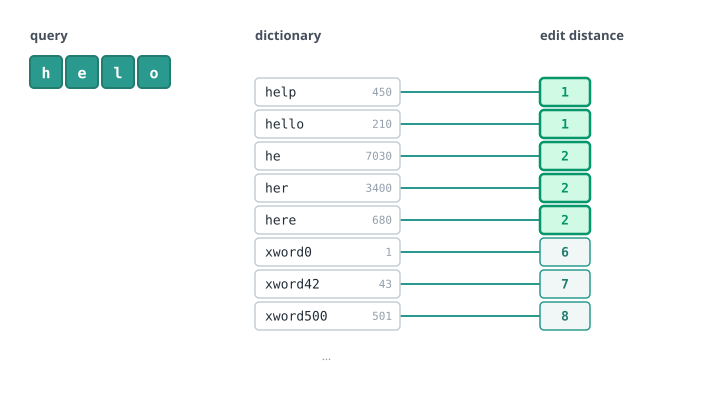
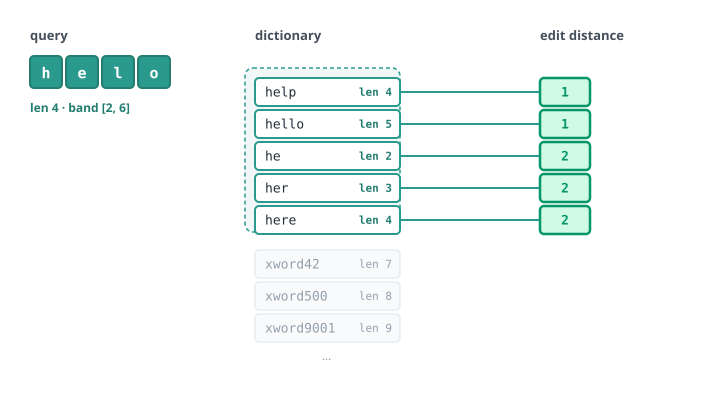

###### Problem Breakdown

# Spell Checker

Published Feb 16, 2025·

easy

###### Try This Problem Yourself

Practice in the AI-enabled editor with real-time feedback

You are given a dictionary that maps words to their frequencies, and a query that might be misspelled. Return up to maxSuggestions real words that are within maxDistance edit operations of the query, ranked by edit distance first (fewer edits wins) and frequency second (more common wins among ties).

"Edit distance" here is the Levenshtein distance, which counts the minimum number of single-character insertions, deletions, or substitutions needed to transform one string into another.

```
query: "helo"    → ["help", "hello", "he", "her", "here"]
query: "hourse"  → ["house", "horse", "hose"]
query: "thier"   → ["the", "this", "they", "her", "there"]
```

Two knobs set the budget. maxDistance defaults to 2, which is the practical upper bound for single-word typos. maxSuggestions caps the result length and defaults to 5.

Tiebreak is worth pausing on. At the same distance, you want to surface the more common word first, because a user's misspelling is much more likely to have targeted a frequent word than a rare one. "teh" should suggest "the" over "he" even though both are within 2 edits.

###### Pattern: Dynamic Programming

Edit distance is the canonical dynamic programming problem. You fill a table where each cell reuses the answers to smaller subproblems, turning an exponential search into a simple grid of lookups.

[Learn This Pattern](/learn/ai-coding/patterns/dynamic-programming)

## Solution 1, scanning everything with full DP

The natural read of the problem is direct. For each candidate word in the dictionary, compute the full edit distance against the query. Keep candidates whose distance is within maxDistance. Sort by (distance ascending, frequency descending). Return the top maxSuggestions words.

If you have not seen Levenshtein before, the computation is a small DP table (see [dynamic programming fundamentals](/learn/code/dynamic-programming/fundamentals) for the general pattern). Let source and target be the two strings. Build a (m+1) × (n+1) grid where cell [i][j] holds the minimum edits to turn the first i characters of source into the first j characters of target. Rows index into source characters and columns index into target characters, so dp[i][0] means "delete i chars from source to reach the empty target" and dp[0][j] means "insert j chars of target into the empty source." The first row and column are seeded with 0, 1, 2, ... because transforming an empty string into a prefix of length k takes exactly k insertions (or deletions the other way). Every other cell is the minimum of three options. A substitution takes dp[i-1][j-1] plus 0 if the characters match or plus 1 if they differ. Inserting a character from target costs dp[i][j-1] + 1. Deleting a character from source costs dp[i-1][j] + 1.

To make this concrete, consider turning source = "cat" into target = "car". The table is 4×4. Row 0 is [0, 1, 2, 3] because turning the empty source into "", "c", "ca", "car" costs 0, 1, 2, 3 insertions. Column 0 fills the same way downward. Cell [1][1] compares c to c, a match, so it inherits dp[0][0] = 0. Cell [2][2] compares a to a, also a match, inheriting dp[1][1] = 0. Cell [3][3] compares t to r, a mismatch, so it equals min(dp[2][2] + 1, dp[2][3] + 1, dp[3][2] + 1) = 1. That 1 at the bottom-right is the answer: one substitution turns "cat" into "car".

The bottom-right cell dp[m][n] is the distance. It represents transforming all m characters of source into all n characters of target, which by definition is the full edit distance between the two strings. One DP table gives you one distance, and you run it once per candidate word.



Scanning a 50,088-word dictionary and computing the DP for every candidate

The visual shows the scan in action for query helo. Every candidate in the dictionary gets an edit distance computed. Two candidates come back at distance 1 and three more at distance 2, which is the useful result; the other tens of thousands of candidates come back at distances ≥ 3, but we paid for a full DP table on each of them to find that out.

Full scan

```
def edit_distance(source: str, target: str) -> int:
    m, n = len(source), len(target)
    dp = [[0] * (n + 1) for _ in range(m + 1)]
    for i in range(m + 1):
        dp[i][0] = i
    for j in range(n + 1):
        dp[0][j] = j
    for i in range(1, m + 1):
        for j in range(1, n + 1):
            sub = dp[i - 1][j - 1] + (0 if source[i - 1] == target[j - 1] else 1)
            ins = dp[i][j - 1] + 1
            dele = dp[i - 1][j] + 1
            dp[i][j] = min(ins, dele, sub)
    return dp[m][n]

def suggest(word: str, dictionary: dict[str, int], max_distance: int = 2, max_suggestions: int = 5) -> list[str]:
    scored = []
    for candidate, freq in dictionary.items():
        dist = edit_distance(word, candidate)
        if dist <= max_distance:
            scored.append((candidate, dist, freq))
    scored.sort(key=lambda r: (r[1], -r[2], r[0]))
    return [r[0] for r in scored[:max_suggestions]]
```

A few details in the code are worth tracing through. The DP table is reallocated per candidate, so every call to editDistance builds a fresh (m+1) × (n+1) grid, fills it, returns a number, and throws the grid away. That allocation cost is small on a single call but it adds up, because this function runs once per dictionary word.

The sort key is (distance asc, frequency desc, word asc). Distance goes first because fewer edits is always a better match, and frequency goes second so that among candidates at the same distance, the more common word surfaces first. A final tiebreak on the word itself keeps the output stable when two candidates match every other key, which otherwise leaves the ordering dependent on dictionary iteration order.

Notice also that filtering happens after the DP, since the if dist <= maxDistance guard is a post-hoc filter. We pay for the full distance computation and then throw most of those results away, even when the candidate could have been rejected without computing anything.

### Complexity

Let D be the number of dictionary entries, L the average candidate length, and Q the query length. Each DP call builds an (Q+1) × (L+1) table, so the cost per call is O(Q · L). The scan runs that for every dictionary entry, so the total is O(D · Q · L). Sort adds O(K log K) over the K surviving candidates, which is negligible when K is small.

### Where it breaks

On the test dictionary of about 90 words, queries finish in under a millisecond. The scan is not the problem.

On the 50,088-word large dictionary, each query runs roughly 280 ms because each query triggers 50,088 full DP computations. A batch of 10 queries comes in near 2.7 s, inside the 5 s test budget but far from interactive. Spell checking wants single-digit milliseconds, and 280 ms per query is nowhere near that.

## Solution 2, rejecting on length before running the DP

The fix is to skip the DP entirely for most candidates by checking a cheap lower bound first. Each of the three edit operations changes the source length by at most one: substitution keeps the length the same, deletion removes one character, and insertion adds one, so after k edits the source length can differ from the target length by at most k. If you need to turn an m-character string into an n-character string, you need at least |m - n| operations that change length, which means the edit distance is at least |m - n|.

Whenever |len(candidate) - len(query)| already exceeds maxDistance, the distance is guaranteed to exceed maxDistance too, and the candidate is not a plausible suggestion. One subtraction and one absolute value tell you this without running the DP at all.

Concretely, if the query is helo (length 4) and maxDistance is 2, any candidate with length outside [2, 6] is out. That one-line guard skips the full DP on every candidate whose length is 1, 7, 8, 9, 10, or more.



Length filter keeps only candidates whose length is within the band around the query

The visual shows the same query against the same dictionary. A dashed teal band marks the in-band length range [2, 6]. Candidates inside the band still get the DP. Candidates outside the band get a length check and nothing more. In the 50,088-word dictionary the band for a length-4 query holds only 96 candidates, which means we skip the DP on 49,992 words out of 50,088.

Length filter

```
def edit_distance(source: str, target: str) -> int:
    m, n = len(source), len(target)
    dp = [[0] * (n + 1) for _ in range(m + 1)]
    for i in range(m + 1):
        dp[i][0] = i
    for j in range(n + 1):
        dp[0][j] = j
    for i in range(1, m + 1):
        for j in range(1, n + 1):
            sub = dp[i - 1][j - 1] + (0 if source[i - 1] == target[j - 1] else 1)
            ins = dp[i][j - 1] + 1
            dele = dp[i - 1][j] + 1
            dp[i][j] = min(ins, dele, sub)
    return dp[m][n]

def suggest(word: str, dictionary: dict[str, int], max_distance: int = 2, max_suggestions: int = 5) -> list[str]:
    scored = []
    word_len = len(word)
    for candidate, freq in dictionary.items():
        if abs(len(candidate) - word_len) > max_distance:
            continue
        dist = edit_distance(word, candidate)
        if dist <= max_distance:
            scored.append((candidate, dist, freq))
    scored.sort(key=lambda r: (r[1], -r[2], r[0]))
    return [r[0] for r in scored[:max_suggestions]]
```

The shape of the code is almost identical to Solution 1, and the one thing that matters is that the guard runs before the DP call. Computing abs(len(candidate) - len(query)) is a few instructions, whereas computing a full DP table for an 8 × 6 grid is thousands of instructions plus an allocation. Putting the cheap check first means most candidates never pay for the expensive one. Everything else, the DP itself, the filter, the sort, and the slice, stays exactly as it was in Solution 1.

### Complexity

The asymptotic worst case stays the same at O(D · Q · L), because a pathological dictionary where every word is close to the query's length would not let us skip anything. In practice the constant factor in front of D collapses to the number of in-band candidates, call it D'. On the 50,088-word dictionary, D' ≈ 100 for short-query cases and tops out near 1,000 when the query is long enough to catch one of the crowded length buckets. That is a one to two order of magnitude reduction in the work per query.

### Where it actually lands

On the 50,088-word dictionary, each query drops from ~280 ms to 1–2 ms, with the worst case (hourse, length 6) finishing in about 7 ms because its band picks up the 900 length-8 entries. A batch of 10 queries comes in near 22 ms.

Compared to the scan baseline's 2.71 s, that's roughly 123× faster on the same inputs, and the 22 ms batch runs more than 200× inside the 5 s test budget.

There are two standard next steps if you ever need more speed than this. A [BK-tree](https://en.wikipedia.org/wiki/BK-tree) indexes the dictionary by pairwise edit distances so the triangle inequality can prune whole subtrees in one step. The way it works is that each node stores a word and groups its children by their edit distance from that word, so a query with max distance k only needs to descend into children whose bucket label falls in the range [d - k, d + k] where d is the query's distance to the current node. Ukkonen's banded DP stops filling a row of the DP table once every entry exceeds maxDistance, cutting the per-call cost of the DP itself. Both are reasonable to name as follow-ups in an interview, but the length filter alone already runs more than 200× inside the budget for this problem.

## Benchmarks

Both variants produce byte-identical suggestion lists, so the only thing this comparison surfaces is how much work the length filter skips.

| Dataset | Queries | Full scan total | Length filter total | Speedup |
| --- | --- | --- | --- | --- |
| test (~88 words) | 4 | 0.8 ms | 0.7 ms | ~1.0× |
| **large (50,088 words)** | **10** | **2.71 s** | **22 ms** | **123×** |

On the small test dictionary of 88 words the filter is a tie, because running the DP on all 88 is as quick as filtering most and running the DP on the remaining handful, so under these benchmarked conditions the savings don't show up until the dictionary gets large. On the 50,088-word dictionary the savings scale with how much of the dictionary falls outside the band, and the synthetic filler skews heavily long (40,000 of the 50,088 entries are length 10, another 9,000 are length 9). Short queries (lengths 3–5) throw away more than 99% of the dictionary on the length check alone; longer queries throw away less but still clear more than 97%.

## Takeaways

The DP has a cheap lower bound, and that lower bound is enough to reject most of the dictionary without ever running the full computation. Candidates who write the full-scan version first and only then think about filtering are doing exactly the right thing; the scaffolding of the problem practically demands that shape of solution.

The more general pattern is worth holding onto. Whenever you have a cheap function that under-approximates an expensive function, gate the expensive one on the cheap one. Triangle-inequality pruning in metric spaces works the same way. So do bloom-filter prefilters in front of a set lookup and bounding-box checks in front of exact geometric intersection. The domains differ, but the move is the same, which is to do the easy rejection before you do the hard computation.

Every solution in this article builds the same DP table the same way. What changes is how often you have to build it.
