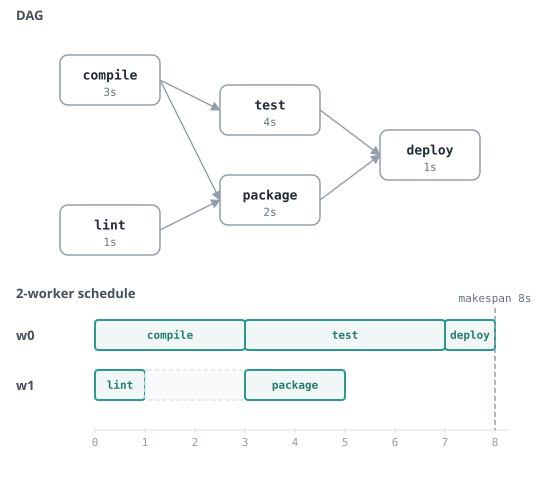
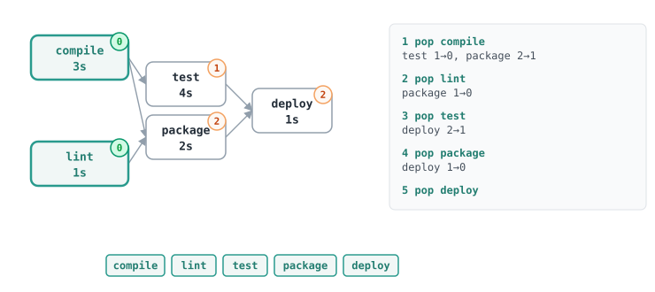
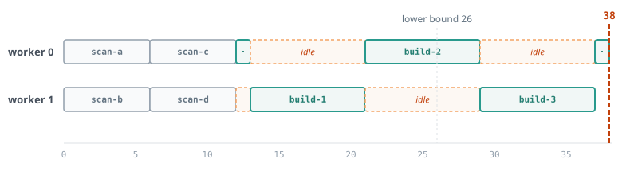
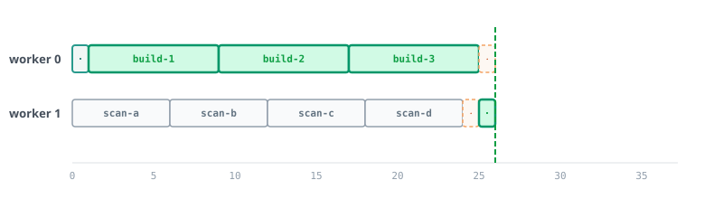

###### Problem Breakdown

# Task Scheduler

Published Feb 16, 2025·

medium

###### Try This Problem Yourself

Practice in the AI-enabled editor with real-time feedback

You're given a set of tasks. Each task has a string name, an integer duration, and a list of names it depends on. The Scheduler class already stores them, checks that dependency names are known and that no two tasks directly reference each other in a 2-cycle, and exposes two helpers worth remembering. One helper returns every task that's currently ready to run given a set of completed tasks; call this the *ready-task helper*. The other returns the earliest moment a given task could start, given a map of when each of its dependencies finished; call this the *earliest-start helper*. You implement two methods on the Optimizer.

The first method returns a valid linear order (a [topological sort](/learn/code/graphs/course-schedule-ii) of the dependency graph). Every dependency must appear before every task that depends on it. The second method returns a parallel schedule across a fixed number of workers, giving you a total makespan plus a timeline that says when each task runs.



The 5-task dependency DAG with durations on each node, and below it the 2-worker Gantt chart showing the 8-second schedule

The test suite has three graphs. The first two are small and well-behaved. The third is a *critical-path graph* where five tasks form a long chain that dominates the minimum possible makespan, plus four long-running independent "scans" that look tempting to schedule early but have nothing to do with the chain.

###### Pattern: Topological Sort

Tasks with prerequisites form a dependency graph, and Kahn's algorithm peels off whatever has no remaining dependencies, one layer at a time. That's topological sort, the backbone of scheduling and build-order problems.

[Learn This Pattern](/learn/ai-coding/patterns/topological-sort)

## Solution 1, topological sort with Kahn's algorithm

The order question has a standard answer in [topological sort](/learn/code/graphs/topological-sort). In a dependency graph, a topological order is any sequence where every task comes after all of its dependencies. There are typically many valid orders; you just need one.

Kahn's algorithm builds one by tracking, for each task, how many of its dependencies are still unmet. A task with zero unmet dependencies is *ready*. Start with all the zero-count tasks in a queue. Pop one, add it to the output order, and decrement the unmet-count of every task that was waiting on it. Whenever a count drops to zero, that task just became ready, so push it into the queue. Keep draining until the queue is empty.



Kahn's algorithm on the test graph showing in-degree counts, queue drain, and resulting order

The visual walks through the 5-task graph step by step. compile and lint start with zero unmet dependencies (teal badges), so they seed the queue. Popping compile drops test from one dependency to zero and package from two to one. Popping lint drops package from one to zero. Now test and package are both ready. They come out next, followed by deploy once both of its upstreams are done.

Kahn's topological sort

```
def compute_execution_order(self) -> List[str]:
    from collections import deque

    tasks = self.scheduler.get_all_tasks()

    in_degree = {t.name: len(t.depends_on) for t in tasks}
    dependents: Dict[str, List[str]] = {t.name: [] for t in tasks}
    for task in tasks:
        for dep in task.depends_on:
            dependents[dep].append(task.name)

    queue = deque(name for name, deg in in_degree.items() if deg == 0)
    order: List[str] = []

    while queue:
        name = queue.popleft()
        order.append(name)
        for dep_name in dependents[name]:
            in_degree[dep_name] -= 1
            if in_degree[dep_name] == 0:
                queue.append(dep_name)

    self.execution_order = order
    return order
```

The input tells you, for each task, what it depends on, but Kahn needs to know which tasks depend on each one. That's the dependents map, which we build in one pass over the tasks. The reason the direction matters is that the input stores "task X depends on Y" as a Y-to-X edge, and Kahn processes tasks whose prerequisites are all done. When a task finishes, we need to iterate its dependents to decrement their in-degree counters, so we need the reverse adjacency list. Alongside it we keep an in-degree counter, in\_degree[task], tracking how many of a task's dependencies are still unfinished. Every time a dependency gets popped, the counter for each of its dependents drops by one, and the moment one hits zero that task is ready and joins the queue.

One subtlety matters for the next solution. Kahn processes zero-in-degree tasks in whatever order you inserted them into the queue. Two tasks can be ready at the same moment (like compile and lint at the start) and the tie-breaker is just the initial iteration order. That's fine for correctness here because any topological order is valid, but the fixed-order scheduler below consumes this sequence verbatim, so whatever order Kahn hands it is what it works with.

### Complexity

O(V + E) where V is the number of tasks and E is the total number of dependency edges. Building the reverse graph visits every edge once (O(E)). Kahn's main loop then visits every vertex once, and for each vertex decrements the in-degree of its successors, touching each edge one more time (another O(E) summed across all vertices). That gives O(V) + O(E) + O(E), which collapses to O(V + E).

### What this solves, and what it doesn't

Kahn's output is a single sequence of tasks in a valid order. On one worker you could run that sequence straight through, starting each task after the previous one finishes and respecting durations, which takes 11 seconds for the example graph.

The problem asks for multiple workers, though, and a linear order doesn't say anything about how to spread work across parallel workers or which task two free workers should pick up first. Knowing what order the tasks can run in is a different question from knowing how to schedule them across a pool of workers.

## Solution 2, fixed-order worker assignment

The obvious way to convert the Kahn order into a parallel schedule is to walk it one task at a time and hand each task to whichever worker is free earliest. That's a [greedy](/learn/code/greedy/overview) list-scheduling approach, and it needs a way to track worker availability along with a rule for when each task can actually start.

The worker-availability side is handled with a **[min-heap](/learn/code/heap/overview)** of (available\_time, worker\_id) pairs. A min-heap keeps the smallest key on top, so pop always returns the worker that will be free next. Both operations are O(log W) for W workers, which for this problem is tiny.

The start-time rule is a bit more subtle. A task can only run once its dependencies have finished and a worker is free, so the start time is max(earliest\_dependency\_finish, worker\_available\_time). The Scheduler's earliest-start helper gives you the first half, but the starter ships it computing min across the dependency completion times when it should be max. A task waits on its *last* prerequisite, not its first, so correct that to max before you build anything on top of it. The single-dependency chain in this graph hides the difference, but the large graph has tasks with two prerequisites that finish at different times, and min would let them start before one of their inputs is done. With the helper fixed, the heap pop handles worker availability and the larger of the two values is when the task actually starts.



Fixed-order schedule of the critical-path graph showing idle gaps and a 38-second makespan

The Gantt chart shows this approach on the critical-path graph with two workers. The four scans have no dependencies and they sit at the front of the graph, so Kahn emits them before setup. The order comes out scan-a, scan-b, scan-c, scan-d, setup, build-1, build-2, build-3, finalize. Both workers grab scans right away and stay busy with them through t=12. Only then does setup get a worker, running t=12 to t=13, and the build chain doesn't start until t=13. The makespan comes out 38 seconds, 12 more than this graph actually requires, almost all of it the build chain sitting idle while the scans hog both workers.

Fixed-order worker assignment

```
def parallel_schedule(
    self, num_workers: int
) -> Tuple[int, Dict[str, Tuple[int, int]]]:
    import heapq

    if not self.execution_order:
        self.compute_execution_order()

    workers: List[Tuple[int, int]] = [(0, i) for i in range(num_workers)]
    heapq.heapify(workers)
    completion_times: Dict[str, int] = {}
    timeline: Dict[str, Tuple[int, int]] = {}

    for name in self.execution_order:
        task = self.scheduler.get_task(name)
        earliest = self.scheduler.earliest_start(name, completion_times)
        worker_free, worker_id = heapq.heappop(workers)
        start = max(earliest, worker_free)
        end = start + task.duration
        timeline[name] = (start, end)
        completion_times[name] = end
        heapq.heappush(workers, (end, worker_id))

    total_time = max((end for _, end in timeline.values()), default=0)
    return total_time, timeline
```

The loop iterates the Kahn order exactly once, committing to an assignment for each task as soon as it's seen. The earliest-start helper, now using max, keeps the schedule anchored to the dependency graph, since without it a later task in the list might get scheduled before its upstream task has finished. The worker-id tiebreak handles the case where two workers are free at the same moment, popping the smaller id so the schedule stays deterministic. The tests check the total makespan and that the schedule is feasible, so any optimal schedule passes. Feasible means every task runs for its declared duration, no more than W tasks run at once, and every dependency finishes before its dependent starts.

### Complexity

O(V log W) for V tasks and W workers. Each task does one heap pop and one heap push, both O(log W). Kahn's O(V + E) setup runs once before the scheduling loop. When W is large the heap work dominates and the setup drops out. Here W is small, so Kahn's linear pass can actually cost more, which is why the fuller bound is O(V log W + V + E) even though the notation often just shows O(V log W).

### Where it breaks

The basic and large graphs don't have a long dependency chain forced to compete with independent filler work, so the Kahn order lines up well enough with what the schedule actually needs.

On the critical\_path graph it returns **38 seconds** instead of the expected 26. The critical path of the graph, setup → build-1 → build-2 → build-3 → finalize, is 1 + 8 + 8 + 8 + 1 = 26 seconds. That's the lower bound, and no schedule can finish sooner because those five tasks have to run one after another. The fixed-order scheduler takes 38 because it spends the first twelve seconds running scans on both workers, so setup doesn't even start until t=12 and the build chain not until t=13.

The plan, not the code, is what's wrong. The Kahn order was computed up front, before anything ran, and it happened to list all four scans ahead of setup. Walking that order commits both workers to scans, and by the time setup and the build chain come up, two thirds of the schedule is already spent. Nothing in the loop ever asks whether setup should have gone first.

## Solution 3, event-driven simulation

Two things have to change. First, stop pre-committing to an order and re-ask "what's ready right now?" every time a worker becomes free, so a newly-unblocked task can be *considered* the instant its predecessor finishes. Second, when more than one task is ready at that moment, hand the free worker to the one with the most work still hanging off it instead of whatever happens to come back first. Reactivity by itself isn't enough on this graph. The scans are ready from the start, so a scheduler that just grabs the first ready task still puts both workers on scans and still lands at 38, only it gets there reactively instead of up front. What breaks the tie correctly is a priority.

This is *discrete-event simulation*, where you advance time by jumping straight to the next moment a task finishes instead of ticking second by second. Before the loop starts, compute each task's critical-path length, its own duration plus the longest chain of work that still depends on it. You get these in one sweep from the leaves backward: a task nothing depends on scores just its own duration, and everything upstream adds itself to the longest of its dependents' scores. setup scores 26 because it sits in front of the whole build chain, each scan scores 6 because nothing depends on it, and the build chain lands in between, with build-1 at 25 effectively tied with setup. That number is the priority key.

Then you maintain two heaps. One holds (available\_time, worker\_id) pairs, same as before. The other holds (end\_time, task\_name, worker\_id) tuples for every task in flight. At t=0 you run the assignment step, which takes the ready-task helper's output, sorts it by descending critical-path length, and hands tasks to free workers until either the ready list is exhausted or the workers run out. On the critical-path graph there are five initially-ready tasks, the four scans plus setup, but only two workers, so the sort matters right away. setup outranks every scan and claims a worker at t=0, one scan takes the other, and the remaining three scans sit in the ready pool. Every assigned task pushes its completion event onto the event heap. The main loop then pops the earliest completion event, marks that task done, returns its worker to the pool, and runs the assignment step again against the updated completed set, which now includes whatever just unblocked.



Event-driven schedule hitting the 26-second lower bound: the build chain runs gap-free on worker 0 while scans pack onto worker 1, which also picks up the one-second finalize at the end

On the critical-path graph with two workers, the chain runs without a gap. setup finishes at t=1, which makes build-1 ready. Three scans are still sitting in the ready pool, but build-1's critical-path length dwarfs theirs, so the assignment step gives it the freed worker. It runs 1 to 9 on worker 0, then build-2 claims the same worker 9 to 17, and build-3 runs 17 to 25. Worker 1 packs the four scans back-to-back from 0 to 6, 6 to 12, 12 to 18, 18 to 24. When build-3 frees worker 0 at t=25, finalize is ready, but worker 1 came free a second earlier at t=24, so the heap hands it the last task, 25 to 26. The makespan comes out exactly 26, matching the lower bound.

Event-driven simulation

```
def parallel_schedule(
    self, num_workers: int
) -> Tuple[int, Dict[str, Tuple[int, int]]]:
    import heapq

    tasks = self.scheduler.get_all_tasks()
    dependents: Dict[str, List[str]] = {t.name: [] for t in tasks}
    for task in tasks:
        for dep in task.depends_on:
            dependents[dep].append(task.name)

    critical_length: Dict[str, int] = {}

    def longest_chain(name: str) -> int:
        if name not in critical_length:
            successors = dependents[name]
            duration = self.scheduler.get_task(name).duration
            critical_length[name] = duration + (
                max(longest_chain(s) for s in successors) if successors else 0
            )
        return critical_length[name]

    for task in tasks:
        longest_chain(task.name)

    completed: Set[str] = set()
    completion_times: Dict[str, int] = {}
    timeline: Dict[str, Tuple[int, int]] = {}
    scheduled: Set[str] = set()

    workers: List[Tuple[int, int]] = [(0, i) for i in range(num_workers)]
    heapq.heapify(workers)
    events: List[Tuple[int, str, int]] = []

    def assign_ready(current_time: int) -> None:
        ready = [
            task
            for task in self.scheduler.get_ready_tasks(completed)
            if task.name not in scheduled
        ]
        ready.sort(key=lambda task: (-critical_length[task.name], task.name))
        for task in ready:
            if not workers:
                break
            worker_free, worker_id = heapq.heappop(workers)
            earliest = (
                self.scheduler.earliest_start(task.name, completion_times)
                if task.depends_on
                else 0
            )
            start = max(earliest, worker_free, current_time)
            end = start + task.duration
            timeline[task.name] = (start, end)
            scheduled.add(task.name)
            heapq.heappush(events, (end, task.name, worker_id))

    assign_ready(0)

    while events:
        end_time, name, worker_id = heapq.heappop(events)
        completed.add(name)
        completion_times[name] = end_time
        heapq.heappush(workers, (end_time, worker_id))

        while events and events[0][0] == end_time:
            et, tn, wi = heapq.heappop(events)
            completed.add(tn)
            completion_times[tn] = et
            heapq.heappush(workers, (et, wi))

        assign_ready(end_time)

    total_time = max((end for _, end in timeline.values()), default=0)
    return total_time, timeline
```

The scheduled set is what prevents double-assignment. A task can appear in the ready-task helper's output on multiple calls. It shows up once when its last dependency finishes, and again on any subsequent call if no worker was free to pick it up the first time. Marking it as scheduled the moment a worker grabs it keeps the second-chance lookup from handing it out twice.

Simultaneous completions need a small bit of care. When two tasks finish at the same time, both should release their workers before any new assignment runs, otherwise the first task's completion triggers an assignment that sees one fewer worker than it actually has, producing a later start time than necessary. After the main loop pops one completion, an inner while loop drains any remaining events that share its end time, so every worker finishing at that instant is back in the pool before the next assign\_ready call.

And finally, current\_time propagates into the start-time max. The assignment step takes the current simulated time and folds it in alongside the worker's free time and the dependency-finish time. A task can't start before the moment the assignment is happening, even if a worker and a dependency are both "ready" at some earlier abstract point.

### Complexity

The critical-path lengths take one pass over the graph to compute, O(V + E). After that the cost is driven by the assignment step's rescan. Each task is pushed and popped from the event heap once, O(log V) each, and every assignment call walks the ready-task helper, which is O(V + E). Since the assignment step runs once per completion event, up to V times, that rescan dominates and the whole thing is O(V² + V · E). For the graphs here V is tiny, so none of it is felt. If you needed to scale it, you'd drop the rescan by maintaining the same in\_degree counter Kahn uses, decrementing a dependent's count when each task finishes and marking it ready the moment the count hits zero. That replaces the per-event rescan with one decrement per edge and brings the total down to O((V + E) log V).

### Why this wins on the critical-path test

Two changes together buy the 12 seconds. The first is timing. Fixed-order decides everything at t=0 from an order computed before anything ran, while event-driven decides at each completion event from the current state, so a chain task can be *considered* for a worker the instant its predecessor finishes. The second is the priority, and it matters just as much. Being considered isn't the same as being chosen. At t=0 the scans are ready too, and at t=1 there are still three scans waiting alongside build-1. Without the critical-path-length sort the assignment step would hand the worker to whichever task the ready-task helper returned first. On this graph that's a scan, so you'd be right back at 38, just arriving there reactively instead of up front.

The sort is what makes the chain win. setup outranks every scan at t=0, so it goes first. build-1 outranks the leftover scans at t=1, so it takes the worker the moment setup frees one. Every step of the chain claims a worker within one second of its predecessor finishing, which is exactly what reaching the 26-second lower bound requires. The scans pack onto the second worker around it.

Critical-path-length priority is a heuristic, not a guarantee. It lands on the optimum for all three test graphs here, but scheduling tasks with arbitrary durations on a fixed number of workers under precedence constraints is NP-hard, so no greedy rule is optimal in general. Any work-conserving greedy, one that never leaves a worker idle while some task is ready, carries Graham's 2 - 1/W bound, so its makespan is at most 2 - 1/W times the true optimum. Two workers gives at most 1.5×, eight workers at most 1.875×, and the ratio approaches 2× as W grows. The "2" is the worst case where one worker is still grinding through the last task while every other worker has already gone idle, wasting about half the available parallelism. Prioritizing by longest remaining chain is one of the better-behaved choices inside that bound and is what real build systems lean on, but it stays a heuristic, and you can still build graphs where it leaves a worker idle at the wrong moment.

## Benchmarks

Makespan from each solution on each test graph.

| Graph | Workers | Expected | Fixed-order | Event-driven |
| --- | --- | --- | --- | --- |
| basic | 2 | 8 | 8 | 8 |
| large | 3 | 26 | 26 | 26 |
| critical-path | 2 | 26 | 38 | 26 |

The critical-path row is where the story is. Fixed-order reports 38 where the test expects 26, and that 12-second gap is the entire failure.

## Takeaways

The two parallel-schedule solutions share the same primitives. What separates them is two decisions, when you choose and how you choose.

Fixed-order chooses everything at t=0. It pre-computes one task order and walks it, making placements that were locked in when the order was built. If that order lines up with the critical path you get an optimal schedule. If it doesn't, workers sit idle while dependent chains wait behind filler.

Event-driven fixes both halves. It never commits past the next completion event, so a newly-unblocked task gets considered the moment it's ready, and when several tasks compete for a free worker it takes the one on the longest remaining chain. Drop either half and the critical-path graph falls back to 38. Re-deciding without a priority just grabs a scan reactively, and a priority laid over a fixed pre-built order can't react to who actually finished when.

The move generalizes well past this problem. Whenever a good choice depends on state you don't have yet, decide late and decide by what matters most right now. Build systems, CI runners, and job schedulers all rank ready work by something like critical-path length and re-rank as the run unfolds. The mental shift is from *"sort once, then execute"* to *"execute, and at each event re-ask what's ready and what matters most."*

If you rewrote the scheduler a few times before it passed, each attempt took you closer to the shape of the problem. The first was the straight reading of Kahn's output, the second was greedy list scheduling over that fixed order, and the third treated scheduling as a simulation that re-ranks the ready work at every event.
